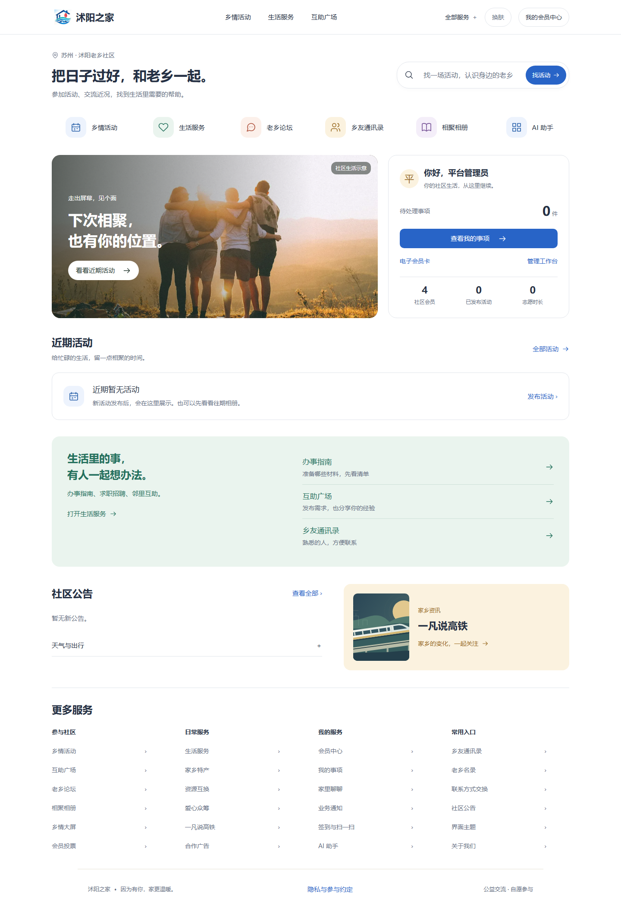
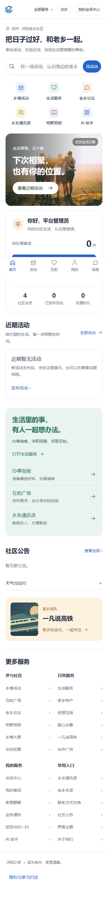
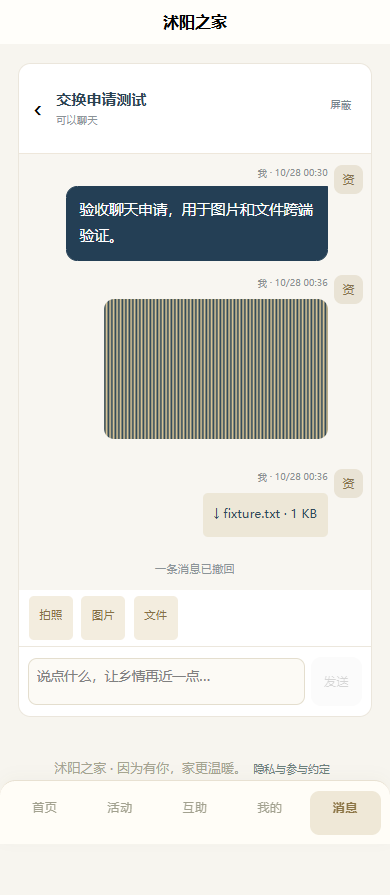
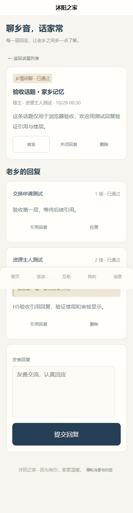
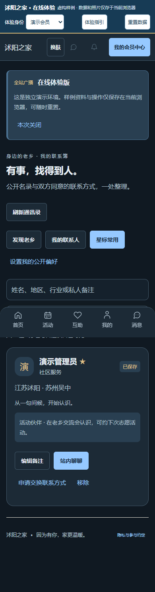
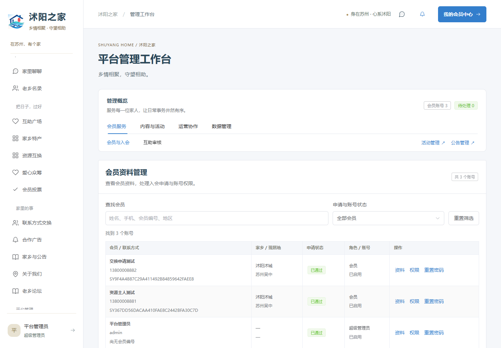

# 沭阳之家 · 会员与乡情社区

[](https://github.com/GuHang2011/shuyang-home/tags) · [版本文件](VERSION) · [更新日志](CHANGELOG.md) · [版本发布规范](docs/版本发布规范.md)

面向在外沭阳老乡的会员平台：相聚、互助、分享家乡好物。由原辅导员系统改造，提供响应式电脑网页、Android / iPhone 手机 H5，以及微信小程序源码，共用真实后端 API。

Web 接入 Element Plus，采用 Airbnb＋飞书参考方向，统一生活社区首页与业务工作台；以浅灰、蓝色、青绿和暖金区分内容，增大正文与表单字号，保留沭阳之家 Logo。当前交付为本地可运行的单实例试点版本；小程序已编译，尚未发布或完成真机验收。

在线体验：[打开沭阳之家体验版](https://guhang2011.github.io/shuyang-home/)。可在顶部切换演示会员／管理员／游客，体验大屏图表／照片视频轮播、通讯录分组星标、换肤、拍照、报名、论坛、聊天、AI 示例、会员二维码和管理流程；样例数据只留在当前浏览器，可随时重置。演示账号 `demo` / `admin`，密码均为 `Demo12345678`。AI 接入与会员码见[功能说明](docs/AI助手与会员二维码-v1.10.0.md)。界面与验收见[本版交付说明](docs/全站界面优化-v1.10.0.md)。

## 界面预览



| 手机首页 | 图片与文件聊天 | 论坛盖楼 |
| --- | --- | --- |
|  |  |  |

[更多截图与说明](docs/screenshots/README.md)。截图中的验收会员、条纹图与验收活动均来自隔离测试环境，不是真实会员或活动素材。

## v1.10.0 界面、AI助手与会员二维码

- [全站界面优化与验收](docs/全站界面优化-v1.10.0.md)：首页分区、完整服务导航、字体层级、主题配色及电脑／手机适配。
- [AI助手与会员二维码](docs/AI助手与会员二维码-v1.10.0.md)：服务器接入OpenAI兼容文本服务；会员卡10分钟有效二维码、扫码核验和刷新撤销旧码。
- Pages提供明确标注的AI固定示例。正式模型需要在服务器配置，密钥不进入前端。

## v1.9.0 大屏、通讯录与生活服务

- 乡情大屏：公共汇总图表、照片／MP4轮播、暂停／切换／全屏和管理素材。
- 乡友通讯录：私人分组、星标、备注和站内联系，实时遵守对方公开及联系方式交换设置。
- 温暖乡情、简洁商务和深色主题选择页，共用现有设备偏好；保留竹青与跟随系统。


| 乡友通讯录 | 手机通讯录 |
| --- | --- |
|  |  |

- 办事指南、老乡帮办、规范招聘、便民服务、活动出行、到货提醒、自提预约、共建公示和失物招领。
- 接入统一事项与通知，支持图片、文字草稿、大字模式、求助者确认办结和二维码自提。
- 首页高铁庆祝悬浮窗直达“一凡说高铁”，关闭后24小时不再显示。
- [使用入口、权限和验收说明](docs/生活服务与高铁悬浮窗-v1.9.0.md)。

## v1.5.0 文件与界面更新

- [会员、报名、订单的文件导入导出与打印](docs/文件导入导出与打印.md)：模板、逐行预览、整批校验、Excel 报表及完整筛选结果打印。
- [Element 界面与验收](docs/Element界面与验收.md)：真实组件、登录校验、工作台分类、会员筛选分页与手机卡片。



## 功能

| 模块 | 已实现 |
| --- | --- |
| 乡情大屏 | 公共汇总、近六个月活动图表、照片／视频轮播、全屏、素材发布／撤下 |
| 乡友通讯录 | 分组、星标、私人备注、搜索、联系方式权限、站内联系 |
| 界面主题 | 温暖乡情／简洁商务／深色选择页，设备保存，竹青与系统偏好 |
| 生活服务 | 指南清单、帮办、岗位、服务名片、出行集合、到货订阅、自提核销、共建公示、失物招领 |
| 我的事项与通知 | 个人进度、管理待办、通知已读、服务详情跳转 |
| 文件与打印 | 会员资料更新、活动报名变更、订单履约；Excel 模板／预览／确认、筛选导出、Web/H5 打印与保存 PDF、小程序导出供打印 |
| 会员与权限 | 自愿入会、审核、资料与公开偏好、电子会员卡及10分钟有效二维码、工作人员扫码核验、名录、超级管理员／普通管理员／组织者、账号停启与审计 |
| AI 助手 | 服务端配置 OpenAI 兼容文本接口、使用指引、问答与文案草稿、同意后发送、连续对话与手动重试；演示站提供标注的本机固定示例 |
| 活动与签到 | 会员发起、人工审核、可报名／我已报名／已结束筛选、报名／取消、名额控制、志愿时长、地点半径与时间窗口校验、现场短时二维码 |
| 一凡说高铁 | 专题资讯／原创解读、来源展示、区域示意、问答、发布编辑撤下及移动分享 |
| 乡情论坛 | 主题审核、照片多选与预览、语音上传与播放、纯图片／语音回复、楼层与引用回复、转发、分板块版主、拉黑、禁言、移出／恢复、隐藏／恢复、删帖、关闭回复 |
| 资源与互助 | 分类检索、供需发布、人工审核、交换申请、排他接受、双方确认交付 |
| 内部聊天 | 双方同意的私聊、自愿群聊、12张内置[聊天表情](docs/聊天表情包.md)、图片／文件发送、拍照入口、分页、未读、两分钟撤回、屏蔽 |
| 联系方式 | 主动选择分享信息、双方同意后互见、拒绝与撤销 |
| 乡情相册 | Web／H5／小程序管理相册、照片多选与拍照、上传进度与失败重试、隐藏／恢复、外部原相册入口 |
| 家乡特产 | 图文展示、分类搜索、库存、在线下单、取消退库存、人工确认、线下结算登记、发货／自提、收货 |
| 社区共建 | 人工审核广告与排期、单选／多选投票、物资／志愿服务／资金意向众筹 |
| 城市与设备 | Open-Meteo 天气、城市／区县搜索、设备定位与网络城市估算、H5／电脑摄像头扫码与图片识码、小程序原生扫码 |

广告不接支付。众筹只记录物资、志愿服务和资金意向，不在线收款。特产在线下单后人工确认、线下结算。论坛“移出”限制账号在指定板块的访问与参与，公开内容仍可由访客浏览。

## 快速启动

环境：Node.js 18+、npm、JDK 8 与 Maven wrapper。首次安装需要访问 npm / Maven 仓库。

在项目根目录分别打开两个 PowerShell 终端：

```powershell
powershell -ExecutionPolicy Bypass -File .\Start-Backend.ps1 -Build
powershell -ExecutionPolicy Bypass -File .\Start-Frontend.ps1
```

访问 `http://127.0.0.1:8888`，后端默认端口 `9999`。首次启动交互设置超级管理员 `admin` 的初始密码，首次登录强制改密；无内置通用管理员密码。默认数据库为 `backend/data/shuyang-home.mv.db`。

手机 H5 / 微信小程序：

```powershell
cd frontend
npm ci
cd mobile
npm ci
npm run dev:h5
# 构建发布产物
npm run build:h5
npm run build:mp-weixin
```

微信开发者工具导入 `mobile/dist/build/mp-weixin`。正式使用前填写真实 AppID、HTTPS API 地址，配置 request / uploadFile / downloadFile 合法域名与隐私声明。手机相机和定位需要 HTTPS 或本机 localhost 安全上下文。详见[启动与部署](docs/启动与部署.md)。

## 代码结构

| 目录 | 职责 |
| --- | --- |
| `backend` | Java / Spring Boot / JDBC / H2 后端及集成测试 |
| `frontend/src` | Vue 3 响应式网页、运营工作台 |
| `frontend/mobile` | uni-app H5 与微信小程序 |
| `frontend/shared` | 多端业务逻辑、权限状态、天气、扫码与文案 |
| `deploy` | Nginx、systemd 与环境变量模板 |
| `docs` | 需求、部署、问题修复、验收和截图 |
| `scripts` | 启动、隔离测试、构建打包与发布校验 |

从 v1.2.1 起，前端统一放在 `frontend`，后端统一放在 `backend`；启动、测试和打包入口已同步更新。已有本地安装的路径迁移见[目录迁移说明](docs/目录迁移说明.md)。学生数据未迁移，旧源码、数据库、缓存、日志、依赖目录和本地打包产物不上传仓库。

## 验证结果

2026-10-31（v1.3.0）：后端 **65 项测试通过**；前端 **146 项回归通过**（包含照片队列和78项模块／功能设计回归）；Web / uni-app 类型检查、Web / H5 / 微信小程序生产构建通过。新增综合业务21项、订单13项、会话恢复4项以及17个导航验收通过。

浏览器已验证附件跨端接收下载、订单到收货、论坛审核隐藏恢复、相册上传与展示、二维码图片识别及模拟定位签到。新增 Chromium / WebKit 七种移动环境检查 **224 项通过**、异常场景 **21 项通过**；覆盖320px小屏、横屏、平板、键盘高度、微信UA、深色与减少动画偏好、英文与海外时区。Windows WebKit缺少摄像头接口，权限拒绝模拟跳过1项，图片扫码降级通过。上述模拟不能替代 iOS Safari、Android 微信及微信小程序真机验收。

- [需求与改造方案](docs/需求与改造方案.md)
- [v1.3.0 全模块问题清单与逐项修复](docs/全模块测试与优化-2026-10-31.md)
- [一凡说高铁专题](docs/一凡说高铁专题.md)
- [移动端轮测与逐项修复](docs/移动端轮测与修复.md)
- [完整验收记录](docs/验收记录.md)
- [实用功能与后续路线图](docs/实用功能设计与路线图.md)
- [论坛语音使用说明](docs/论坛语音.md)
- [照片上传与界面优化](docs/照片上传与界面优化.md)
- [首页轮播说明](docs/首页轮播说明.md)
- [三角色测试与优化](docs/三角色测试与优化-2026-10-30.md)
- [移动端多环境测试](docs/移动端多环境测试-2026-10-30.md)
- [测试脚本说明](scripts/README.md)

## 当前边界与素材

- 仍使用 Java 8 / Spring Boot 2.3 和单实例 H2；公网正式运营前需升级受维护依赖、完成容量、备份与部署验收。
- 聊天为定时刷新，无 WebSocket、音视频或离线推送；手机号账号由人工审核，没有短信认证、微信一键登录或支付。
- 小程序真实 AppID、微信平台配置、手机摄像头／键盘／前后台切换和真机定位验收仍待完成。
- 用户提供的 Alltuu 活动相册访问返回 403，原照片未导入。目前提供原相册入口和本地上传功能。验收条纹图仅用于测试。
- JSON 业务记录支持可选 AES 加密；附件存于数据库 BLOB，未由该字段加密机制覆盖，需通过主机与备份存储措施保护。
- 保留上游前端 [MIT 许可证与原作者声明](frontend/LICENSE)。沭阳之家 Logo、介绍与活动照片不因仓库公开而获得额外的品牌或图片使用授权。
