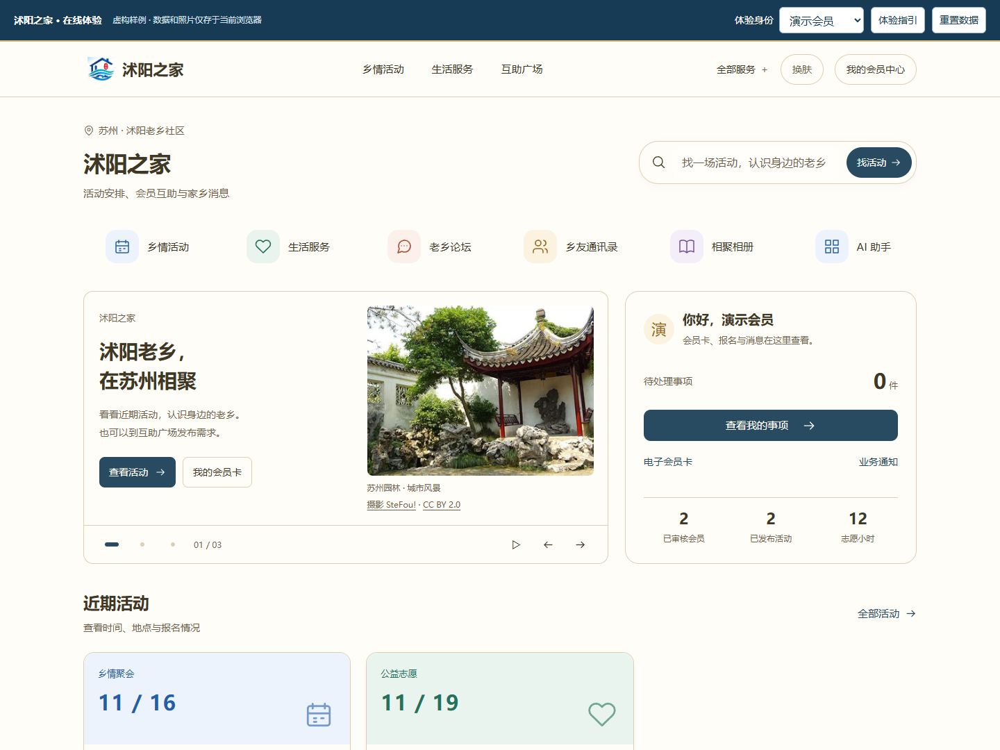
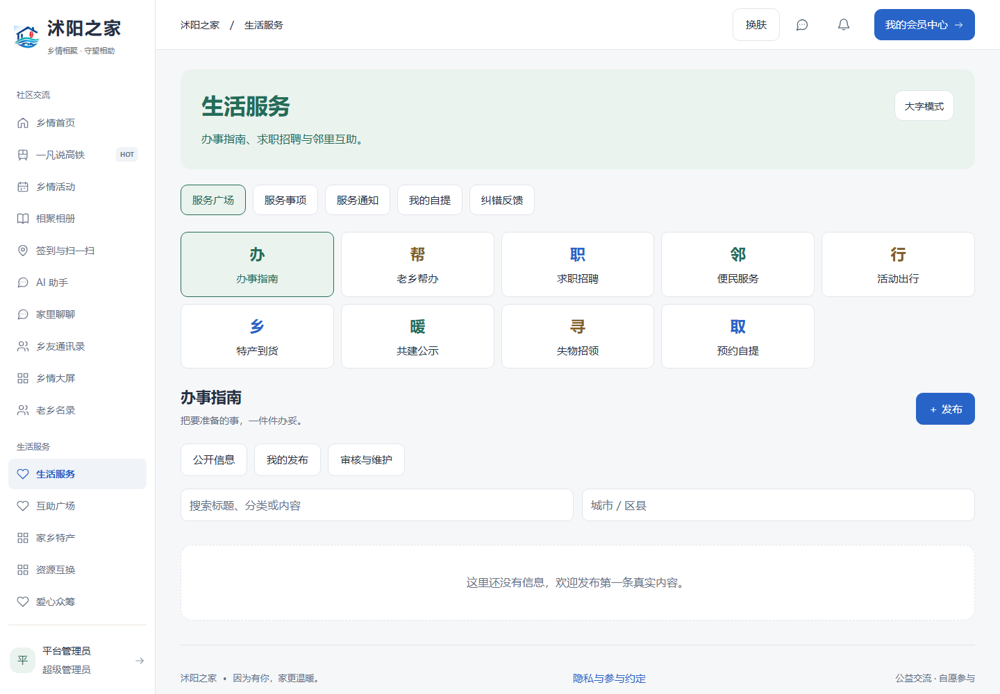
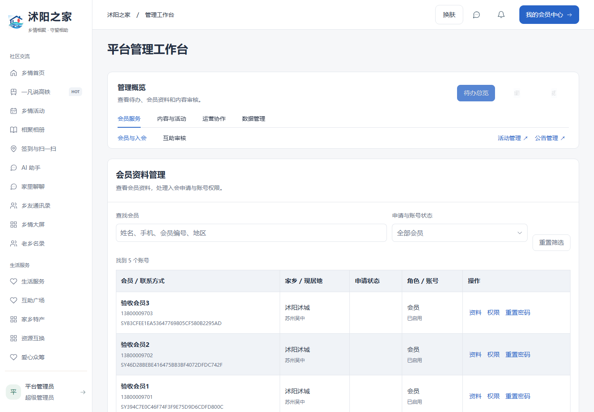
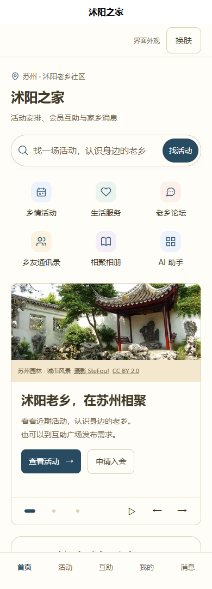
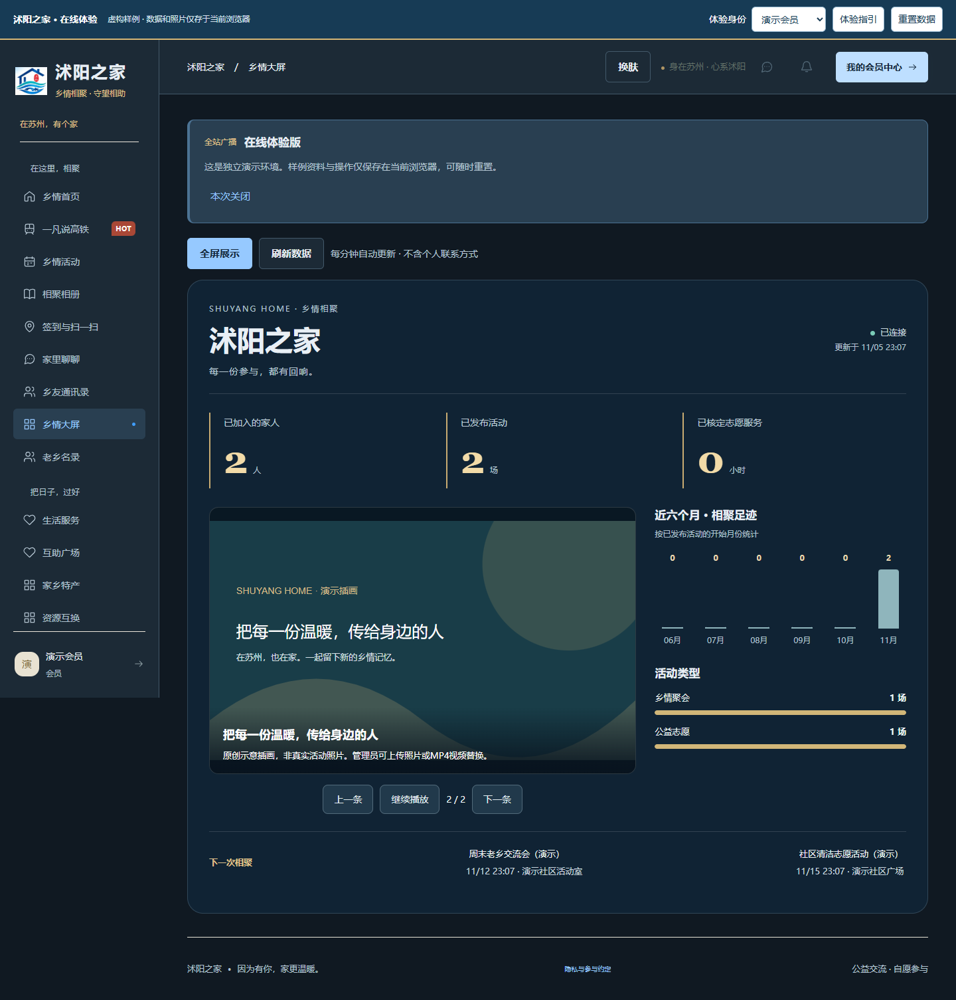
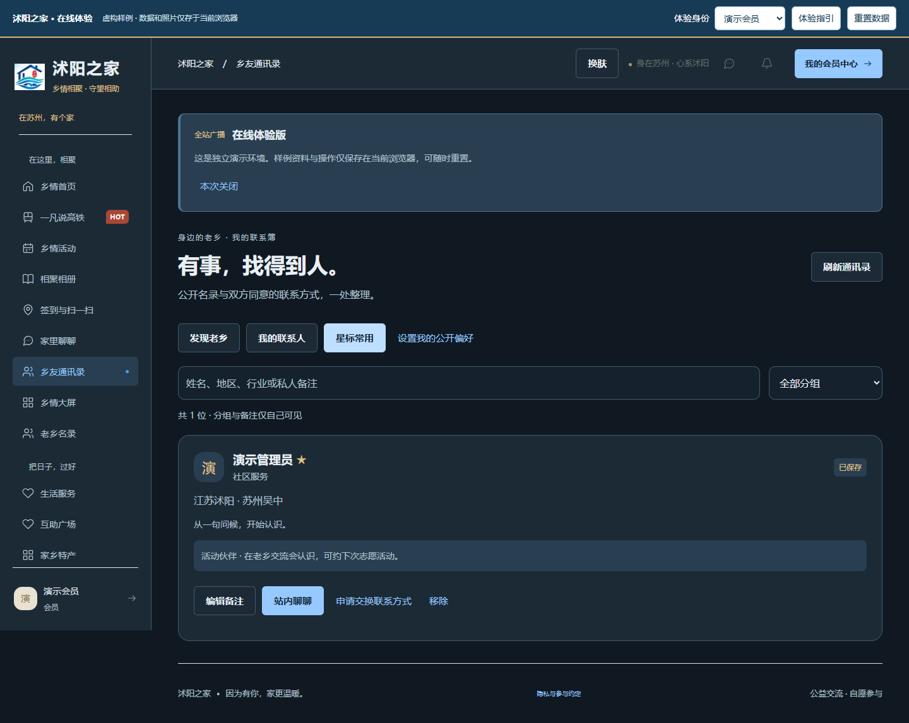

<div align="center">
  
  <h1>沭阳之家 · 会员与乡情社区</h1>
  <p>在苏州的沭阳老乡交流平台。</p>
  <p>活动相聚 · 生活互助 · 会员服务 · 家乡交流</p>
  <p>
    <a href="https://guhang2011.github.io/shuyang-home/"><strong>打开在线演示</strong></a> ·
    <a href="docs/启动与部署.md">部署文档</a> ·
    <a href="CHANGELOG.md">更新记录</a>
  </p>
</div>

[](https://github.com/GuHang2011/shuyang-home/tags)
[](https://github.com/GuHang2011/shuyang-home/actions/workflows/pages-demo.yml)
[](https://github.com/GuHang2011/shuyang-home/actions/workflows/version-check.yml)

面向在外沭阳老乡的生活社区，将会员服务、活动报名、论坛聊天、便民互助和运营管理放在一起。提供 **电脑网页、手机 H5 与微信小程序源码**，正式部署共用后端 API。

基于 **Vue 3 · TypeScript · Element Plus · uni-app · Spring Boot**。当前为可本地运行的单实例试点版本；GitHub Pages 提供无需安装的独立体验版。

[在线体验](#在线体验) · [界面预览](#界面预览) · [核心功能](#核心功能) · [快速启动](#快速启动) · [验证结果](#验证结果) · [文档导航](#文档导航)

[](https://guhang2011.github.io/shuyang-home/)

## 在线体验

**体验地址：[guhang2011.github.io/shuyang-home](https://guhang2011.github.io/shuyang-home/)**

1. 打开页面，默认以演示会员身份进入；电脑和手机均可访问。
2. 用顶部“体验身份”切换会员、管理员或游客，按下表体验主要流程。
3. 点击“重置数据”可恢复初始样例；“体验指引”提供操作说明。

| 体验身份 | 建议从这里开始 |
| --- | --- |
| 演示会员 | 首页搜索活动 → 报名；会员中心 → 出示二维码；论坛、聊天、相册与换肤 |
| 演示管理员 | 管理工作台 → 会员／内容审核；会员中心 → 核验会员码；大屏、商品与广播管理 |
| 游客 | 浏览首页、活动、社区内容和家乡专题，了解平台入口 |

如需使用登录表单，演示账号为 `demo`／`admin`，演示密码均为 `Demo12345678`。这些账号只属于独立体验版，正式部署需自行设置管理员密码。

> [!NOTE]
> 演示资料与附件只保存在当前浏览器，不同访客之间不共享，不产生真实消息、交易或收款。AI 使用明确标注的固定示例，真实模型需在后端配置 OpenAI 兼容服务。文件报表、完整生活服务及定位签到请在完整部署版本中验收。

## 界面预览

首页采用真实城市照片、简短的功能说明与常用入口，减少装饰和重复口号。活动搜索与个人事项前置，工作台按业务分组；正文主要为16px，保留温暖乡情、简洁商务和深色主题。

| 生活服务 | 会员资料管理 |
| --- | --- |
| [](docs/screenshots/refined-life-110.png) | [](docs/screenshots/refined-members-110.png) |

<details>
<summary>展开查看手机首页、乡情大屏与通讯录</summary>

<p align="center">
  
</p>

| 乡情大屏 | 乡友通讯录 |
| --- | --- |
| [](docs/screenshots/display-190.png) | [](docs/screenshots/contacts-190.png) |

</details>

截图使用隔离环境或独立演示中的虚构资料。园林是城市实景，朋友相聚照片是生活示意。[查看完整截图](docs/screenshots/README.md) · [本轮验收](docs/真实素材与首页优化-v1.10.2.md) · [素材来源](docs/素材来源.md)

## 近期更新

- **v1.10.2 真实素材与首页整理**：园林实景轮播、素材署名与官网入口，简化文案并修复H5宽屏和320px控制条布局。
- **生活社区界面**：重做首页、统一全站字体与配色，补齐手机和平板导航，改善表格、表单和深色主题可读性。
- **AI 助手**：支持文字问答、使用指引和文案草稿，服务端接入 OpenAI 兼容接口；使用前确认，密钥保留在后端。
- **电子会员卡二维码**：10分钟有效，刷新撤销旧码；工作人员可扫码、选择图片或粘贴核验。
- **生活与社区服务**：乡友通讯录、大屏展示、办事指南和帮办流程，接入个人事项及业务通知。

当前版本以 [VERSION](VERSION) 为准；完整记录见 [CHANGELOG.md](CHANGELOG.md)，发布遵循[语义化版本规范](docs/版本发布规范.md)。

## 核心功能

| 模块 | 已实现 |
| --- | --- |
| 乡情大屏 | 公共汇总、近六个月活动图表、照片／视频轮播、全屏、素材发布／撤下 |
| 乡友通讯录 | 分组、星标、私人备注、搜索、联系方式权限、站内联系 |
| 界面主题 | 温暖乡情／简洁商务／深色选择页，设备保存，竹青与系统偏好 |
| 生活服务 | 指南清单、帮办、岗位、服务名片、出行集合、到货订阅、自提核销、共建公示、失物招领 |
| 我的事项与通知 | 个人进度、管理待办、通知已读、服务详情跳转 |
| 文件与打印 | 会员资料更新、活动报名变更、订单履约；Excel 模板／预览／确认、筛选导出、Web/H5 打印与保存 PDF、小程序导出供打印 |
| 会员与权限 | 自愿入会、审核、资料与公开偏好、电子会员卡及10分钟有效二维码、工作人员扫码核验、名录、超级管理员／普通管理员／组织者、账号停启与审计 |
| AI 助手 | 服务端配置 OpenAI 兼容文本接口、使用指引、问答与文案草稿、同意后发送、连续对话与手动重试；演示站提供标注的本机固定示例 |
| 活动与签到 | 会员发起、人工审核、可报名／我已报名／已结束筛选、报名／取消、名额控制、志愿时长、地点半径与时间窗口校验、现场短时二维码 |
| 一凡说高铁 | 专题资讯／原创解读、来源展示、区域示意、问答、发布编辑撤下及移动分享 |
| 乡情论坛 | 主题审核、照片多选与预览、语音上传与播放、纯图片／语音回复、楼层与引用回复、转发、分板块版主、拉黑、禁言、移出／恢复、隐藏／恢复、删帖、关闭回复 |
| 置顶、热帖与广播 | 板块置顶、热帖筛选；全站文字＋语音广播、预约生效、到期与撤下 |
| 资源与互助 | 分类检索、供需发布、人工审核、交换申请、排他接受、双方确认交付 |
| 内部聊天 | 双方同意的私聊、自愿群聊、12张内置[聊天表情](docs/聊天表情包.md)、图片／文件发送、拍照入口、分页、未读、两分钟撤回、屏蔽 |
| 联系方式 | 主动选择分享信息、双方同意后互见、拒绝与撤销 |
| 乡情相册 | Web／H5／小程序管理相册、照片多选与拍照、上传进度与失败重试、隐藏／恢复、外部原相册入口 |
| 家乡特产 | 图文展示、分类搜索、库存、在线下单、取消退库存、人工确认、线下结算登记、发货／自提、收货 |
| 社区共建 | 人工审核广告与排期、单选／多选投票、物资／志愿服务／资金意向众筹 |
| 城市与设备 | Open-Meteo 天气、城市／区县搜索、设备定位与网络城市估算、H5／电脑摄像头扫码与图片识码、小程序原生扫码 |

广告不接支付。众筹只记录物资、志愿服务和资金意向，不在线收款。特产在线下单后人工确认、线下结算。论坛“移出”限制账号在指定板块的访问与参与，公开内容仍可由访客浏览。

## 快速启动

环境：Node.js 18+、npm、JDK 8 与 Maven wrapper。首次安装需要访问 npm / Maven 仓库。

在项目根目录分别打开两个 PowerShell 终端：

```powershell
powershell -ExecutionPolicy Bypass -File .\Start-Backend.ps1 -Build
powershell -ExecutionPolicy Bypass -File .\Start-Frontend.ps1
```

访问 `http://127.0.0.1:8888`，后端默认端口 `9999`。首次启动交互设置超级管理员 `admin` 的初始密码，首次登录强制改密；无内置通用管理员密码。默认数据库为 `backend/data/shuyang-home.mv.db`。

手机 H5 / 微信小程序：

```powershell
cd frontend
npm ci
cd mobile
npm ci
npm run dev:h5
# 构建发布产物
npm run build:h5
npm run build:mp-weixin
```

微信开发者工具导入 `mobile/dist/build/mp-weixin`。正式使用前填写真实 AppID、HTTPS API 地址，配置 request / uploadFile / downloadFile 合法域名与隐私声明。手机相机和定位需要 HTTPS 或本机 localhost 安全上下文。详见[启动与部署](docs/启动与部署.md)。

## 代码结构

| 目录 | 职责 |
| --- | --- |
| `backend` | Java / Spring Boot / JDBC / H2 后端及集成测试 |
| `frontend/src` | Vue 3 响应式网页、运营工作台 |
| `frontend/mobile` | uni-app H5 与微信小程序 |
| `frontend/shared` | 多端业务逻辑、权限状态、天气、扫码与文案 |
| `deploy` | Nginx、systemd 与环境变量模板 |
| `docs` | 需求、部署、问题修复、验收和截图 |
| `scripts` | 启动、隔离测试、构建打包与发布校验 |

从 v1.2.1 起，前端统一放在 `frontend`，后端统一放在 `backend`；启动、测试和打包入口已同步更新。已有本地安装的路径迁移见[目录迁移说明](docs/目录迁移说明.md)。学生数据未迁移，旧源码、数据库、缓存、日志、依赖目录和本地打包产物不上传仓库。

## 验证结果

**2026-11-09 · v1.10.2** 已完成前端业务回归、后端170项、演示数据层20项与演示页面19项检查。两端类型检查、Web／H5／微信小程序／演示版构建通过；新增三主题、1440／390／320px的首页素材与布局检查。见[本轮验收记录](docs/真实素材与首页优化-v1.10.2.md)。

以下为 **2026-11-06 · v1.10.0** 的全站验收记录，保留便于追溯：

| 检查范围 | 结果 |
| --- | --- |
| 前端业务回归 | 277项通过 |
| 后端测试 | 170项通过 |
| 演示数据层 | 20项通过 |
| 全站页面与布局 | Chromium／Windows WebKit共102项通过 |
| AI与会员二维码页面链路 | 双内核共30项通过 |
| Pages演示流程 | 19项通过；部署后公开站点另通过7项检查 |
| 类型检查与构建 | Web／移动端类型检查，Web／H5／微信小程序／演示版及后端生产构建通过 |

覆盖1440px宽屏、390／320px手机与768／1024px平板导航，包含深色主题、活动搜索、AI同意与失败恢复、会员码刷新失效、账号切换和演示数据隔离。详细记录见[全站界面验收](docs/全站界面优化-v1.10.0.md)与[AI／会员码验收](docs/AI助手与会员二维码-v1.10.0.md)。

v1.10.1整理仓库首页与截图，不改变业务功能；检查文档链接、图片、版本一致性及GitHub发布结果。上述完整回归为v1.10.0的验收记录。真实模型服务、手机摄像头及微信小程序扫码仍需部署环境和真机验收。

## 文档导航

| 需要了解的内容 | 文档 |
| --- | --- |
| 安装、配置与部署 | [启动与部署](docs/启动与部署.md) |
| 新版界面与适配 | [全站界面优化](docs/全站界面优化-v1.10.0.md) |
| 首页实景与来源 | [真实素材与首页优化](docs/真实素材与首页优化-v1.10.2.md) · [素材清单](docs/素材来源.md) |
| 模型接入与会员码核验 | [AI助手与会员二维码](docs/AI助手与会员二维码-v1.10.0.md) |
| 生活服务与家乡专题 | [生活服务与高铁悬浮窗](docs/生活服务与高铁悬浮窗-v1.9.0.md) |
| 大屏、通讯录与主题 | [功能与在线演示](docs/大屏通讯录与在线演示-v1.9.0.md) |
| 业务数据导入、导出和打印 | [文件操作说明](docs/文件导入导出与打印.md) |
| 置顶、热帖和文字／语音广播 | [社区运营功能](docs/置顶热帖与文字语音广播-v1.7.0.md) |
| 测试与版本发布 | [测试脚本](scripts/README.md) · [版本发布规范](docs/版本发布规范.md) |

<details>
<summary>历史需求、设计与测试记录</summary>

- [需求与改造方案](docs/需求与改造方案.md)
- [v1.3.0 全模块问题清单与逐项修复](docs/全模块测试与优化-2026-10-31.md)
- [一凡说高铁专题](docs/一凡说高铁专题.md)
- [移动端轮测与逐项修复](docs/移动端轮测与修复.md)
- [完整验收记录](docs/验收记录.md)
- [实用功能与后续路线图](docs/实用功能设计与路线图.md)
- [论坛语音使用说明](docs/论坛语音.md)
- [照片上传与界面优化](docs/照片上传与界面优化.md)
- [首页轮播说明](docs/首页轮播说明.md)
- [三角色测试与优化](docs/三角色测试与优化-2026-10-30.md)
- [移动端多环境测试](docs/移动端多环境测试-2026-10-30.md)
- [测试脚本说明](scripts/README.md)
- [Element界面与验收](docs/Element界面与验收.md)

</details>

## 当前边界与素材

- 仍使用 Java 8 / Spring Boot 2.3 和单实例 H2；公网正式运营前需升级受维护依赖、完成容量、备份与部署验收。
- 聊天为定时刷新，无 WebSocket、音视频或离线推送；手机号账号由人工审核，没有短信认证、微信一键登录或支付。
- 小程序真实 AppID、微信平台配置、手机摄像头／键盘／前后台切换和真机定位验收仍待完成。
- 用户提供的 Alltuu 活动相册访问返回 403，原照片未导入。目前提供原相册入口和本地上传功能。验收条纹图仅用于测试。
- JSON 业务记录支持可选 AES 加密；附件存于数据库 BLOB，未由该字段加密机制覆盖，需通过主机与备份存储措施保护。
- 保留上游前端 [MIT 许可证与原作者声明](frontend/LICENSE)。沭阳之家 Logo、介绍与活动照片不因仓库公开而获得额外的品牌或图片使用授权。
