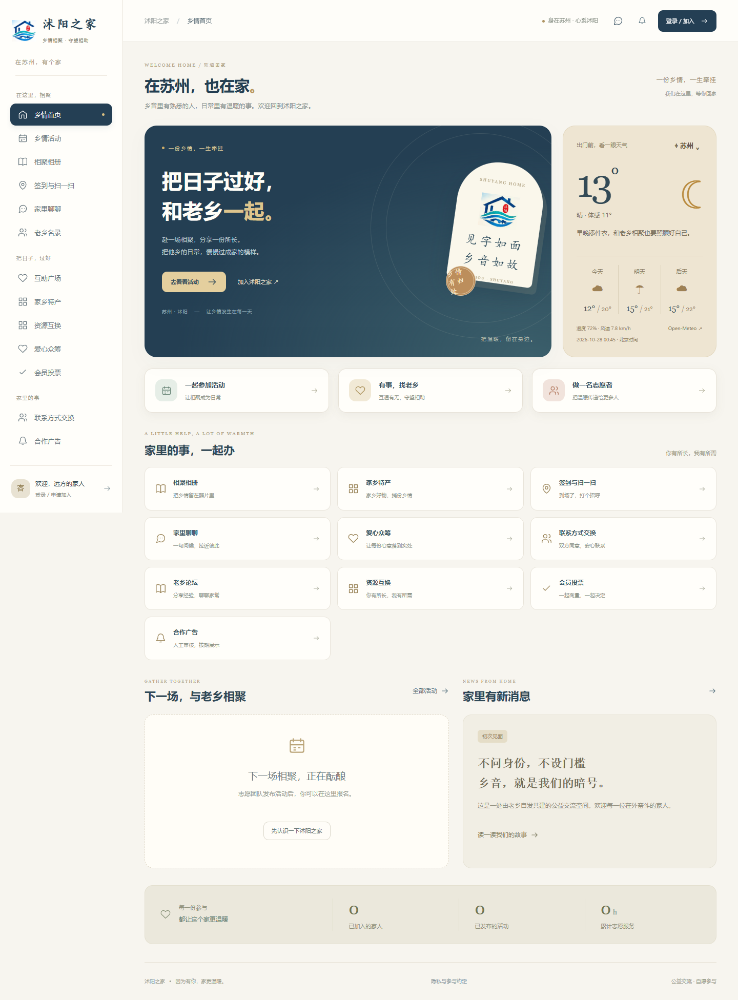

# 沭阳之家 · 会员与乡情社区

面向在外沭阳老乡的会员平台：相聚、互助、分享家乡好物。由原辅导员系统改造，提供响应式电脑网页、Android / iPhone 手机 H5，以及微信小程序源码，共用真实后端 API。

界面采用米白、深蓝、暖金配色，保留沭阳之家 Logo。当前交付为本地可运行的单实例试点版本；小程序已编译，尚未发布或完成真机验收。

## 界面预览



| 手机首页 | 图片与文件聊天 | 论坛盖楼 |
| --- | --- | --- |
|  |  |  |

[更多截图与说明](docs/screenshots/README.md)。截图中的验收会员、条纹图与验收活动均来自隔离测试环境，不是真实会员或活动素材。

## 功能

| 模块 | 已实现 |
| --- | --- |
| 会员与权限 | 自愿入会、审核、资料与公开偏好、电子会员卡、名录、超级管理员／普通管理员／组织者、账号停启与审计 |
| 活动与签到 | 会员发起、人工审核、报名／取消、名额控制、志愿时长、地点半径与时间窗口校验、现场短时二维码 |
| 乡情论坛 | 主题审核、语音上传与播放、纯语音回复、楼层与引用回复、转发、分板块版主、拉黑、禁言、移出／恢复、隐藏／恢复、删帖、关闭回复 |
| 资源与互助 | 分类检索、供需发布、人工审核、交换申请、排他接受、双方确认交付 |
| 内部聊天 | 双方同意的私聊、自愿群聊、图片／文件发送、拍照入口、分页、未读、两分钟撤回、屏蔽 |
| 联系方式 | 主动选择分享信息、双方同意后互见、拒绝与撤销 |
| 乡情相册 | 相册发布、图片上传、照片隐藏／恢复、相册浏览、外部原相册入口 |
| 家乡特产 | 图文展示、分类搜索、库存、在线下单、取消退库存、人工确认、线下结算登记、发货／自提、收货 |
| 社区共建 | 人工审核广告与排期、单选／多选投票、物资／志愿服务／资金意向众筹 |
| 城市与设备 | Open-Meteo 天气、城市／区县搜索、设备定位与网络城市估算、H5／电脑摄像头扫码与图片识码、小程序原生扫码 |

广告不接支付。众筹只记录物资、志愿服务和资金意向，不在线收款。特产在线下单后人工确认、线下结算。论坛“移出”限制账号在指定板块的访问与参与，公开内容仍可由访客浏览。

## 快速启动

环境：Node.js 18+、npm、JDK 8 与 Maven wrapper。首次安装需要访问 npm / Maven 仓库。

在项目根目录分别打开两个 PowerShell 终端：

```powershell
powershell -ExecutionPolicy Bypass -File .\Start-Backend.ps1 -Build
powershell -ExecutionPolicy Bypass -File .\Start-Frontend.ps1
```

访问 `http://127.0.0.1:8888`，后端默认端口 `9999`。首次启动交互设置超级管理员 `admin` 的初始密码，首次登录强制改密；无内置通用管理员密码。默认数据库为 `CropDiseasesDetection_springboot/data/shuyang-home.mv.db`。

手机 H5 / 微信小程序：

```powershell
cd CropDiseasesDetection_vue
npm ci
cd mobile
npm ci
npm run dev:h5
# 构建发布产物
npm run build:h5
npm run build:mp-weixin
```

微信开发者工具导入 `mobile/dist/build/mp-weixin`。正式使用前填写真实 AppID、HTTPS API 地址，配置 request / uploadFile / downloadFile 合法域名与隐私声明。手机相机和定位需要 HTTPS 或本机 localhost 安全上下文。详见[启动与部署](docs/启动与部署.md)。

## 代码结构

| 目录 | 职责 |
| --- | --- |
| `CropDiseasesDetection_springboot` | Java / Spring Boot / JDBC / H2 后端及集成测试 |
| `CropDiseasesDetection_vue/src` | Vue 3 响应式网页、运营工作台 |
| `CropDiseasesDetection_vue/mobile` | uni-app H5 与微信小程序 |
| `CropDiseasesDetection_vue/shared` | 多端业务逻辑、权限状态、天气、扫码与文案 |
| `deploy` | Nginx、systemd 与环境变量模板 |
| `docs` | 需求、部署、问题修复、验收和截图 |
| `scripts` | 启动、隔离测试、构建打包与发布校验 |

旧工程目录名暂时保留，以兼容既有构建路径。学生数据未迁移，旧源码、数据库、缓存、日志、依赖目录和本地打包产物不上传仓库。

## 验证结果

2026-10-28：后端 **60 项测试通过**；共享逻辑 **17 个异步响应场景通过**（业务5项、天气12项）；Web / uni-app 类型检查、Web / H5 / 微信小程序生产构建通过。

浏览器已验证附件跨端接收下载、订单到收货、论坛审核隐藏恢复、相册上传与展示、二维码图片识别及模拟定位签到。Web 与 H5 首页和聊天在 360×800、390×844、412×915、844×390、768×1024 尺寸下无页面横向溢出，检查到的可见按钮均至少 44px 高。上述为 Edge 尺寸模拟，不能替代 iOS Safari、Android 微信及微信小程序真机验收。

- [需求与改造方案](docs/需求与改造方案.md)
- [移动端轮测与逐项修复](docs/移动端轮测与修复.md)
- [完整验收记录](docs/验收记录.md)
- [实用功能与后续路线图](docs/实用功能设计与路线图.md)
- [论坛语音使用说明](docs/论坛语音.md)
- [测试脚本说明](scripts/README.md)

## 当前边界与素材

- 仍使用 Java 8 / Spring Boot 2.3 和单实例 H2；公网正式运营前需升级受维护依赖、完成容量、备份与部署验收。
- 聊天为定时刷新，无 WebSocket、音视频或离线推送；手机号账号由人工审核，没有短信认证、微信一键登录或支付。
- 小程序真实 AppID、微信平台配置、手机摄像头／键盘／前后台切换和真机定位验收仍待完成。
- 用户提供的 Alltuu 活动相册访问返回 403，原照片未导入。目前提供原相册入口和本地上传功能。验收条纹图仅用于测试。
- JSON 业务记录支持可选 AES 加密；附件存于数据库 BLOB，未由该字段加密机制覆盖，需通过主机与备份存储措施保护。
- 保留上游前端 [MIT 许可证与原作者声明](CropDiseasesDetection_vue/LICENSE)。沭阳之家 Logo、介绍与活动照片不因仓库公开而获得额外的品牌或图片使用授权。
