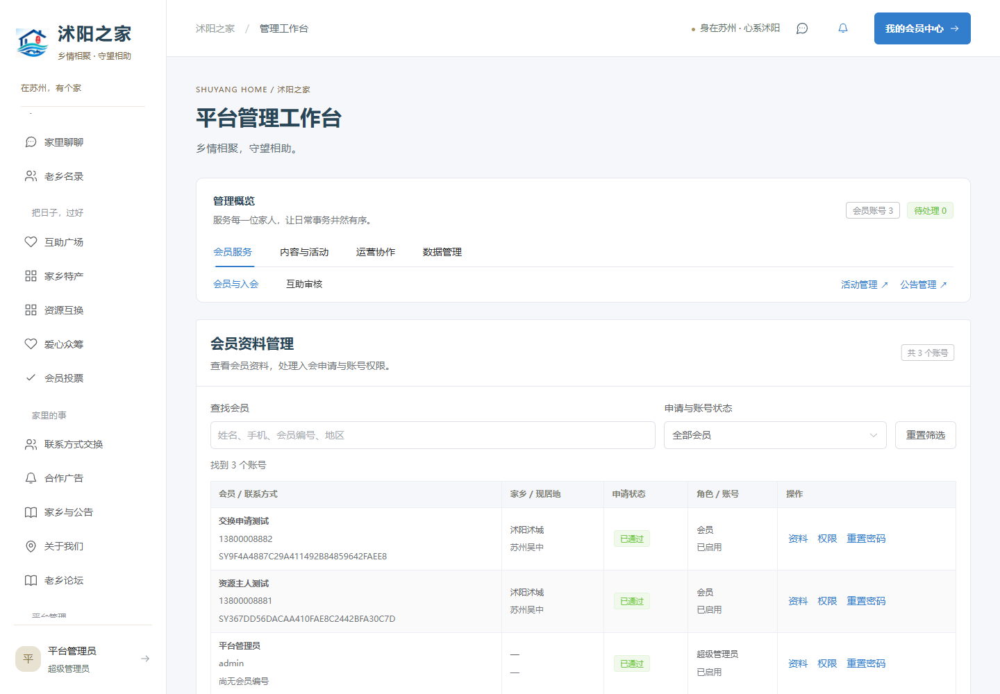
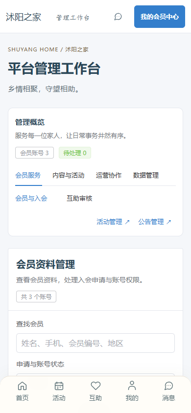
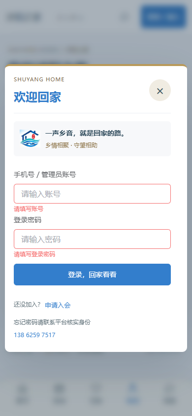
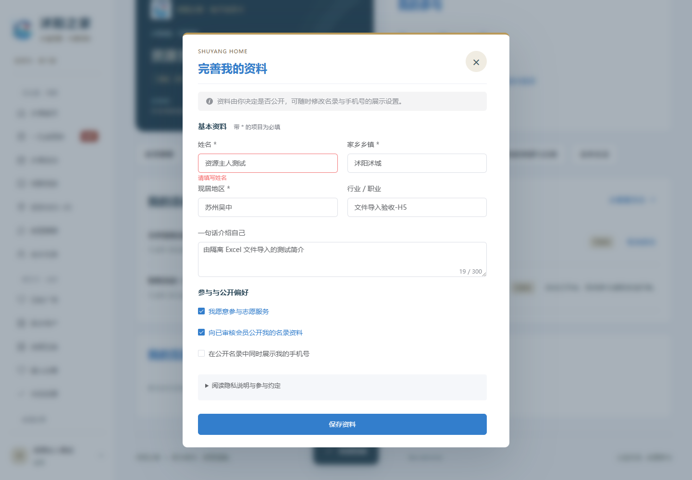

# Element 界面与验收

v1.5.0 先查看 [Element 官网配色](https://element.eleme.cn/#/zh-CN/component/color)、[表单](https://element.eleme.cn/#/zh-CN/component/form)与[表格](https://element.eleme.cn/#/zh-CN/component/table)，再按现有业务迁移。旧版 Element UI 针对 Vue 2，本项目的 Web 使用 Vue 3，因此接入 Element Plus 2.14.7，并将 Web Vue 更新至 3.5.44；移动 uni-app 保持自身兼容版本。

## 已落地的界面

- **登录与资料表单**：使用 `ElForm`、`ElFormItem`、`ElInput`、`ElCheckbox`、`ElButton`，提供字段校验、密码显隐、错误滚动定位与提交状态；保存沿用现有接口、会话保护和隐私选项。
- **管理工作台**：使用 `ElTabs` 分成会员服务、内容与活动、运营协作、数据管理四组，保留所有模块与活动／公告快捷入口。概览显示实际会员账号和待处理数量。
- **会员资料管理**：使用 `ElTable`、`ElSelect`、`ElPagination`，支持搜索、状态筛选、重置和每页 20 条；手机展示会员卡片，资料、审核、权限及重置密码沿用原有操作与角色限制。
- **文件中心**：使用 Element 上传、步骤、表格、分页与结果提示，具体范围见[文件操作说明](文件导入导出与打印.md)。

浅灰背景、白色内容区、细边框和蓝色操作反馈参考官网。保留沭阳之家标志、深蓝标题、暖金品牌点缀、会员卡与乡情文案；主按钮使用官网蓝色系列中更深的 `#337ECC` 以改善白色文字对比度。其余业务模块共享按钮、背景与边框规范，功能和接口保持兼容。

组件按需导入代码和样式，中文配置集中在应用入口。旧表单样式不再覆盖 Element 表单。桌面表格和手机卡片按视口切换，卸载相应尺寸监听；手机输入字号为 16px，主要操作触控高度至少 44px。

## 验收方法

`scripts/browser-element-ui.js` 覆盖登录必填、所有管理模块入口、会员搜索／空状态／筛选／详情、资料保存、公开偏好和普通会员权限。检查 1920×1080、1440×1000、768×1024、390×844、320×568、844×390、390×420 的宽屏、平板、手机、横屏与短视口。

`scripts/browser-business-files.js` 上传真实合成 Excel、下载报表与模板，模拟提交成功但响应丢失后重试，核对完整 25 条订单打印，再检查 Web／H5 在五种尺寸下无页面横向溢出且打印按钮可操作。Chromium 另生成实际 PDF 供内容核对。

运行前启动隔离预览并准备合成数据，按顺序运行每个浏览器脚本，避免两个流程同时修改同一测试会员。日志保留在被 Git 忽略的 `output/`，须以 `### Result` 的完整结果判断成功，不能只看 CLI 退出码。汇总脚本为 `python scripts/summarize-business-files.py`。

浏览器模拟不能替代实体手机键盘、微信容器和物理打印机测试；小程序本轮完成编译与共享逻辑验证，未发布微信版本。

## 本版本结果（2026-11-01）

| 检查 | 结果 |
| --- | --- |
| 前端逻辑回归 | 178 项通过 |
| 后端测试 | 81 项通过，0 失败、0 跳过 |
| Chromium / WebKit 界面 | 每个内核 58 项，共 116 项通过 |
| Chromium / WebKit 文件流程 | 每个内核 50 项，共 100 项通过 |
| 实际下载文件 | 10 份 Excel 的行数与文本单元格检查通过 |
| 实际打印 PDF | 6 页，包含全部 25 个合成订单号 |
| 构建 | Web、H5、小程序成功，两端类型检查通过 |

入会表单额外验证公开偏好默认关闭、必须同意参与约定、提交参数兼容和服务失败后保留内容。此检查截获测试提交并模拟服务失败，不新建会员。

本轮解决了按需样式遗漏导致的字段错误提示不清晰，以及宽度变化时 WebKit 的表格尺寸监听循环；表格改用 Element 支持的自动布局。浏览器脚本在手机旋转后等待布局稳定再校验完整可点击区域。

| 手机工作台 | 手机登录校验 |
| --- | --- |
|  |  |

截图全部来自隔离内存环境，会员名称、手机号和活动均为合成验收数据。
