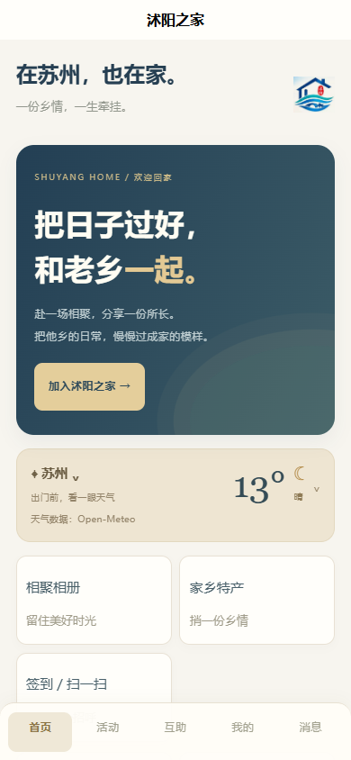
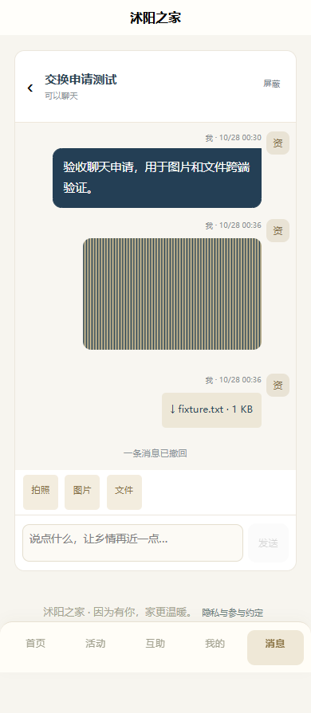
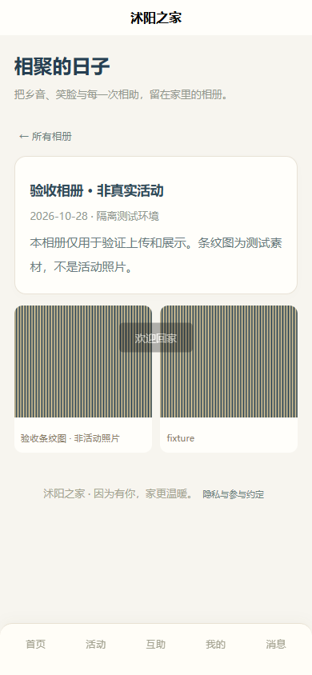
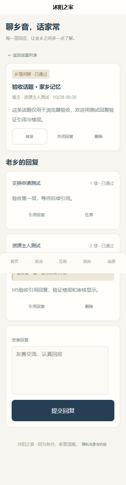
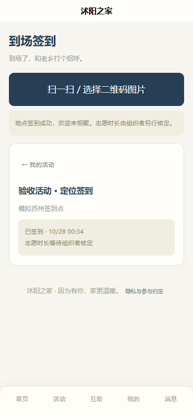
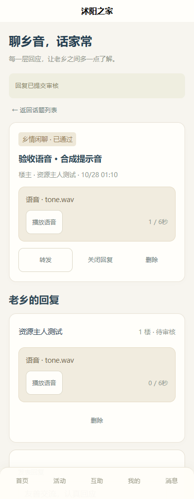
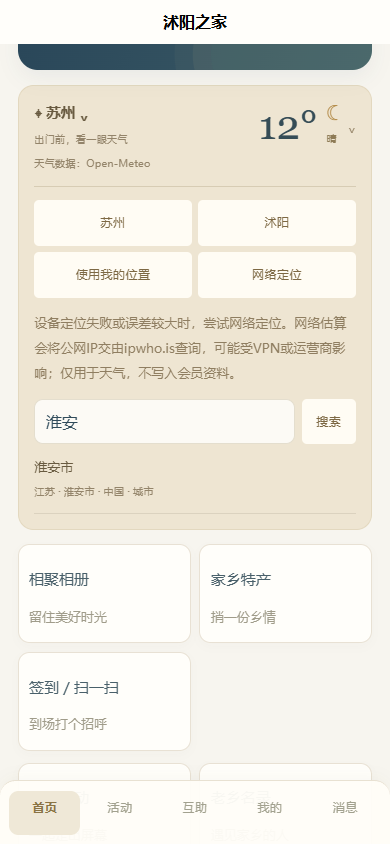

# 界面截图

## v1.11.0 淮新高铁论坛

[电脑讨论区](railway-forum-desktop-1110.png) · [手机H5讨论区](railway-forum-phone-1110.png) · [深色手机讨论区](railway-forum-night-1110.png) · [资料与常识](railway-reference-1110.png)。

本组为Chromium模拟的1440px电脑及390px手机页面，来自隔离演示；帖子、回复与身份均为样例。手机截图不等于微信真机验收。版规和出行话题不代表正式项目消息。功能与实际检查记录见[高铁论坛验收](../淮新高铁论坛-v1.11.0.md)。

## v1.10.2 真实素材首页

[电脑首页](home-materials-desktop-1102.png) · [手机H5首页](home-materials-phone-1102.png) · [深色首页](home-materials-night-1102.png)。

本组为2026-11-09的Chromium页面截图，电脑1440×1080、H5为390×1080。通过页面关闭临时广播与高铁悬浮窗后截取，未修图。业务资料来自隔离演示，照片用途和许可见[素材来源](../素材来源.md)。

## 仓库首页预览

[电脑首页摘要](community-home-overview.png) · [手机首页摘要](community-home-phone-overview.png)。用于v1.10.1仓库首页，裁取v1.10.0已验收界面的首屏区域，未修改页面内容；完整截图见下方生活社区界面章节。

## 截图来源

截图来自本机Edge，移动端为390×844模拟。首页为清空验收数据后的访客视图；其余为隔离内存库验收内容。测试会员、条纹图片、论坛内容、活动及坐标为合成数据，不代表真实会员、活动或商品；没有真实交易。原Alltuu照片未导入。

| 预览 | 说明 |
| --- | --- |
| [电脑首页](desktop-home.png) | 响应式网页与天气API展示 |
| [手机首页](mobile-home.png) | uni-app H5会员入口 |
| [图片与文件聊天](mobile-chat.png) | 测试图片、TXT与撤回提示 |
| [乡情论坛](mobile-forum.png) | 楼层与引用回复 |
| [相聚相册](mobile-gallery.png) | 合成条纹测试图，非活动照片 |
| [地点签到](mobile-checkin.png) | 模拟定位，非真实到场证明 |

[论坛语音帖子与回复](mobile-forum-audio.png)：390×1000视口，6秒合成提示音，非真人录音。

天气选城修复：以下截图使用真实城市搜索结果，输入“淮安”显示江苏淮安市，新增网络定位入口。未展示用户的真实定位信息。

[电脑选城](desktop-weather-city.png) · [手机选城](mobile-weather-city.png)

[电脑会员欢迎页](desktop-member-welcome.png) · [手机会员欢迎页](mobile-member-welcome.png)：访客状态，统一按钮高度、对齐和会员服务说明。

## 2026-10-30 字体与照片功能

[手机首页](mobile-readable-home.png) · [电脑照片帖子](desktop-forum-photos.png) · [手机照片帖子](mobile-forum-photos.png) · [多照片上传预览](mobile-photo-upload.png)

本组移动截图为390×900，图片为程序生成的山水示例，不是真实活动照片；会员和帖子为隔离验收数据。上传预览中的照片尚未提交。

## v1.5.0 Element 界面

新增电脑／手机工作台、登录校验与资料编辑截图，均为合成测试数据。详见[界面与验收](../Element界面与验收.md)。

## v1.9.0 大屏、通讯录与生活服务

[乡情大屏](display-190.png) · [主题选择](themes-190.png) · [通讯录](contacts-190.png) · [手机通讯录](contacts-phone-190.png) · [手机大屏](display-phone-190.png)。大屏、主题和通讯录截图使用独立在线演示的虚构资料。

[电脑悬浮窗](railway-celebration-desktop.png) · [手机网页悬浮窗](railway-celebration-phone.png) · [H5悬浮窗](railway-celebration-h5.png) · [生活服务H5](life-h5-170.png)。本组来自隔离演示数据，截图中的人员、指南和活动均为验收示例。

## v1.10.0 生活社区界面

- [新版首页](refined-home-110.png)与[手机首页](refined-home-phone-110.png)
- [生活服务](refined-life-110.png)、[会员资料管理](refined-members-110.png)
- 采用Airbnb＋飞书参考方向，截图使用隔离环境中的虚构资料；首页相聚照片为已注明的生活示意。
