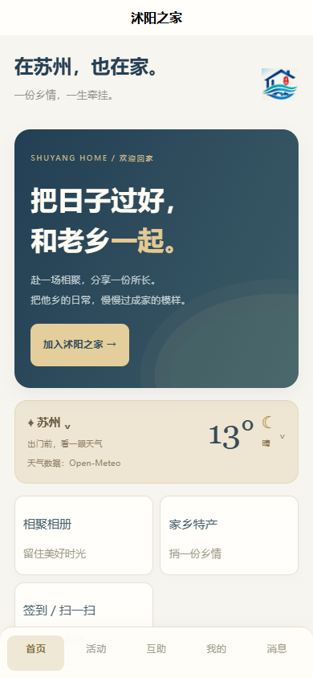
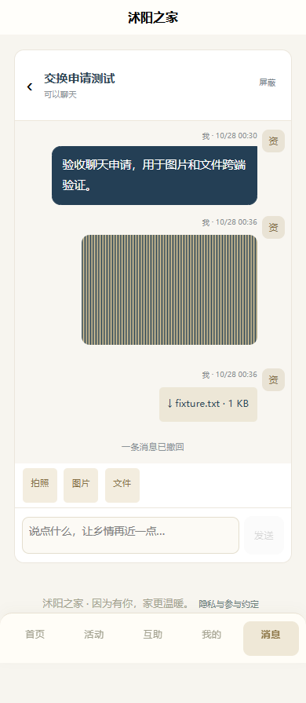
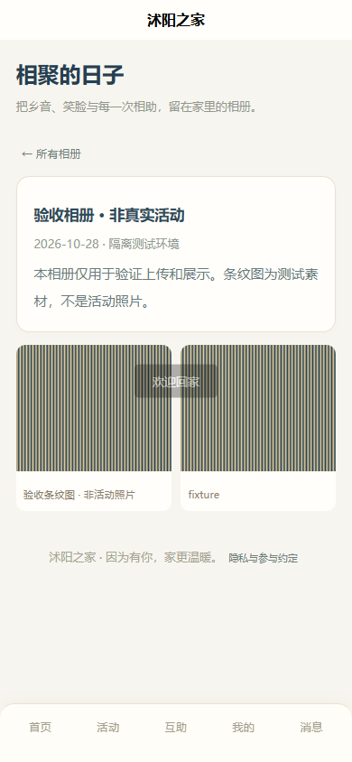
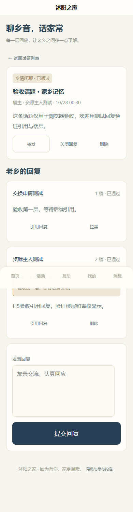
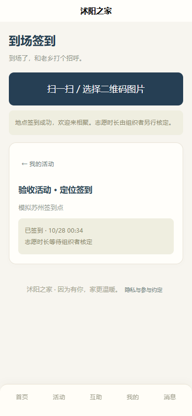
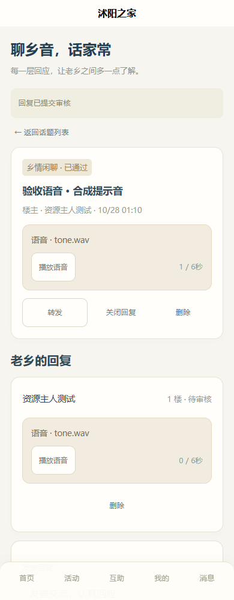
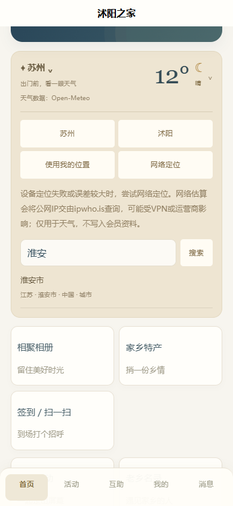

# 界面截图

截图来自本机Edge，移动端为390×844模拟。首页为清空验收数据后的访客视图；其余为隔离内存库验收内容。测试会员、条纹图片、论坛内容、活动及坐标为合成数据，不代表真实会员、活动或商品；没有真实交易。原Alltuu照片未导入。

| 预览 | 说明 |
| --- | --- |
| [电脑首页](desktop-home.png) | 响应式网页与天气API展示 |
| [手机首页](mobile-home.png) | uni-app H5会员入口 |
| [图片与文件聊天](mobile-chat.png) | 测试图片、TXT与撤回提示 |
| [乡情论坛](mobile-forum.png) | 楼层与引用回复 |
| [相聚相册](mobile-gallery.png) | 合成条纹测试图，非活动照片 |
| [地点签到](mobile-checkin.png) | 模拟定位，非真实到场证明 |

[论坛语音帖子与回复](mobile-forum-audio.png)：390×1000视口，6秒合成提示音，非真人录音。

天气选城修复：以下截图使用真实城市搜索结果，输入“淮安”显示江苏淮安市，新增网络定位入口。未展示用户的真实定位信息。

[电脑选城](desktop-weather-city.png) · [手机选城](mobile-weather-city.png)

[电脑会员欢迎页](desktop-member-welcome.png) · [手机会员欢迎页](mobile-member-welcome.png)：访客状态，统一按钮高度、对齐和会员服务说明。

## 2026-10-30 字体与照片功能

[手机首页](mobile-readable-home.png) · [电脑照片帖子](desktop-forum-photos.png) · [手机照片帖子](mobile-forum-photos.png) · [多照片上传预览](mobile-photo-upload.png)

本组移动截图为390×900，图片为程序生成的山水示例，不是真实活动照片；会员和帖子为隔离验收数据。上传预览中的照片尚未提交。
