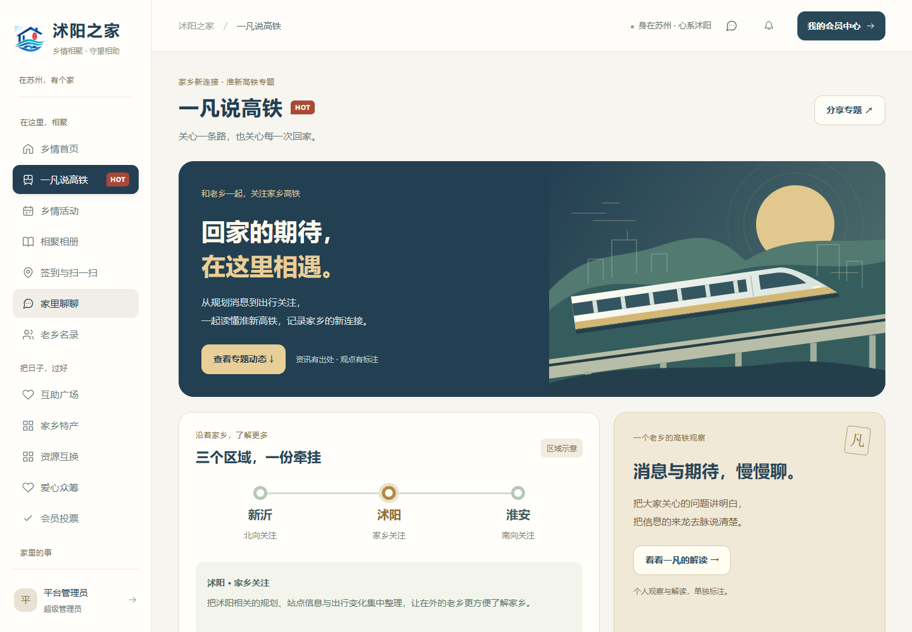
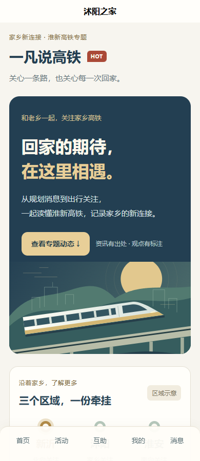

# 一凡说高铁专题与界面优化

版本：1.3.0。模块按最终命名使用“一凡说高铁”，保留 HOT 标签。

## 入口与阅读

- Web：首页专题卡、侧栏第二个栏目、`#railway` 直达链接。
- H5／微信小程序：首页专题卡。小程序分享路径为 `/pages/index/index?section=railway`，H5支持 `/#/?section=railway`。
- 页面包括主题插画、新沂／沭阳／淮安关注区域、专题动态、个人解读、常见问答和官方信息入口。
- 区域图仅用于组织阅读，不表示已批复的站点或施工线路。首版没有预置建设动态及通车时间，避免把未经核实的信息写成事实。

## 内容维护

使用具备公告发布权限的账号（超级管理员、普通管理员、志愿组织者）打开Web专题，点击“发布内容”。手机浏览器访问Web也可管理。

| 分类 | 展示位置 | 公开发布的必填来源 |
| --- | --- | --- |
| 淮新高铁 | 专题资讯 | 来源名称、来源日期、原文链接 |
| 一凡说高铁 | 一凡解读，附“观点”标签 | 作者／来源名称、来源日期；原创无需外链 |

发布后Web与移动端共用公告数据；“编辑”可更新或撤下。撤下内容从专题消失，管理员可在“家乡与公告”中重新编辑。专题标题与正文按纯文本展示；外链限定HTTP／HTTPS，页面不会代用户或服务端抓取外部网址。

后端沿用现有公告存储和权限，无需新数据库表。新分类与来源字段需要更新至1.3.0后端；仅替换前端无法使用新分类发布。

## 样式

延续米白、深蓝与暖金。统一主按钮、次按钮、文字按钮及筛选状态，保持44～46像素操作高度；统一标题层级和名录卡片间距。H5快捷入口改为两列，奇数末项占整行。

## 验证与限制

- 后端65项集成测试通过，其中新增专题权限、必填来源、非法外链／日期、撤下可见性与原创解读测试。
- Web、移动端类型检查及Web／H5／小程序构建通过。
- 独立预览实测管理员发布、访客H5读取、原文链接、全文展开、分类筛选、问答和撤下流程。
- Web首页／名录／专题检查360、390、768、1440像素；H5专题检查320、360、390、768像素，无横向溢出。
- 微信小程序分享、剪贴板及实际iPhone／Android显示仍需真机验收；目前浏览器验收使用Chromium。

本地完整新版预览使用Web 18891、H5 18892与API 19991，数据位于被Git忽略的独立测试目录。原18888／18890预览仍连接旧后端，保留其临时数据；发布功能请使用新版预览。

