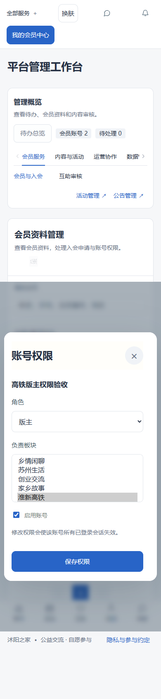

# v2.0.2 上线复查与问题修复

检查开始日期：2026-11-18。基于 v2.0.1 复查活动签到、投票、订单、移动时间输入、生活服务发布、论坛版主管理、附件请求与跨域部署。检查跨至2026-11-19。以下10项为本轮确认的问题及修复；验证结果按本轮实际执行记录填写。

## 问题与修复

| 编号 | 问题及触发条件 | 已完成的修复 |
| --- | --- | --- |
| 1 | 活动改期或换场地后，原签到时间、坐标和二维码仍有效，会员可能在旧时间或旧场地签到 | 开始／结束时间、地点变更或撤下活动后清除旧签到配置及码，组织者必须重新配置；仅修改介绍保留配置 |
| 2 | 票已成功计入，但首次响应丢失，截止后重试相同选择被误报失败 | 先识别该会员已成功的选择并返回结果，再处理新投票的时间校验；不增票、不重复记录审计，仍禁止改票 |
| 3 | 自提时间校验按整数天截断，24小时加1秒至接近48小时都可能通过 | 精确比较24小时，允许24小时整，超出即拒绝 |
| 4 | 手机打开订单取消／确认收货弹窗后切换账号、退出或离开页面，旧确认回调仍可能执行 | 确认绑定身份和组件生命周期；旧回调、已处理回调及被新弹窗替代的回调失效 |
| 5 | 北京时间凌晨先选择时间，默认日期按UTC计算为昨天，跨年也会出错 | 复用统一北京时间转换，保留用户已选日期 |
| 6 | 生活服务已经发布成功，但本机草稿删除异常导致界面提示失败，诱发重复提交 | 服务端成功继续进入详情；单独提示本机草稿暂未清除、无需重复提交；手动清除失败可重试 |
| 7 | 后端支持高铁版主，但管理权限表单的旧四板块列表没有“淮新高铁” | 使用统一论坛板块列表，超级管理员可明确选择“淮新高铁”；不会自动扩大既有版主权限 |
| 8 | 附件请求401不清理过期登录状态，网关返回HTML时显示解析错误，断网或无响应时提示不清楚 | 增加60秒超时、中文重试信息及会话失效处理；旧账号迟到401不会清除新账号会话，权限拒绝保留有效登录 |
| 9 | 多域名配置逗号后包含空格，生产启动校验通过但第二域的跨域预检403 | 实际允许来源统一去除首尾空格、过滤空项；继续精确匹配域名，陌生域与伪造后缀域被拒绝 |
| 10 | 聊天每4秒刷新同一个会话，错误触发身份变化监听，关掉相机、丢弃正在上传的照片／文件结果 | 身份按成员、会话与发送权限的实际值比较；正常刷新保留拍照和上传，真实切换／退出／失去权限／卸载仍取消 |

活动已经有报名时仍遵循原有日程修改限制。活动地点变更会使现有签到配置失效，发布者应在“报名与签到”中重新确认新地点和有效时间，再生成新的签到码。

## 验证证据

| 检查 | 本轮结果 |
| --- | --- |
| 后端 clean verify | 214项，0失败、0错误、0跳过 |
| 前端 test:regression | 361项通过，含附件10项、移动订单／日期／草稿14项及聊天媒体生命周期20项新增回归 |
| 类型检查与构建 | Web vue-tsc、移动端 tsc 通过；Web、H5、微信小程序及独立演示四种构建通过 |
| 演示数据层／浏览器完整流程 | 27项／20项通过，包含聊天轮询期间继续拍照、发送图片、相册和身份隔离 |
| 一凡说高铁浏览器回归 | 32项通过，覆盖Web／H5、三主题、1440／390／320px、字体与音频生命周期 |
| 正式JAR安装与恢复 | 9项通过，含首次改密、申请审核、加密持久化、停机备份及恢复 |
| 真实Nginx HTTPS | 16项通过，另有Web／H5两种手机页面检查及高铁版主任命／保存／刷新持久化流程；390px表单无横向溢出 |

新增测试验证过原缺陷：业务边界5项在旧实现中4失败、1通过；CORS 7项中第二域预检失败；附件10项中旧实现6失败；移动订单／日期／草稿14项中旧实现10失败。聊天媒体20项在旧实现中4失败；原真实页面测试也捕获了刷新导致的相机关停。修复后逻辑回归全部通过。测试只使用合成会员、内存库或临时文件库，不读取真实会员数据。

日志和原始截图存放在被Git忽略的 `.cache`、`output`。下图为临时虚拟会员的高铁版主授权界面，单独保存为交付说明插图，不含真实会员资料。



## 安装与升级

交付包为 `shuyang-home-v2.0.2.zip`，包含后端JAR、Web、H5、微信小程序开发构建、部署模板、配置及验收工具、说明文档和逐文件SHA256清单；另附ZIP校验文件。不含真实数据库、私有配置和通用生产密码。

沿用 JDK 21、H2 2.4 和 v2.0.x 数据格式，从 v2.0.0／v2.0.1 升级无需额外数据迁移。先停机备份数据库和私有配置，再替换JAR与两端静态文件、更新服务链接；保留上一版文件以及仍被旧页面引用的静态哈希资源。已有数据库不要重新生成密码或数据密钥。首次安装及回退步骤见[上线准备](上线准备-v2.0.0.md)。

服务启动后，在新包目录执行：

```bash
python3 tools/check-deployment.py https://自己的域名 --mobile
```

人工验收重点为：活动换地点后必须重新设置签到；高铁版主只管理获授权板块；手机订单操作与北京时间输入正确；登录过期后照片／语音读取能恢复。

## 尚未完成的上线条件

- 未提供正式服务器、域名和微信 AppID，GitHub Pages仍是独立演示环境，本次交付不代表正式上线。
- Android／iPhone微信中的相机、文件选择、定位和小程序交互仍需真机验收，桌面浏览器手机尺寸测试不能替代真机。
- 本轮未变更依赖，v2.0.1记录的32项uni-app依赖告警仍保留（17 high、8 moderate、7 low），未在本轮重新审计；细节与运行边界见[上一轮依赖说明](上线复查与问题修复-v2.0.1.md#依赖修补及剩余事项)。不把构建成功视为告警已消除。
