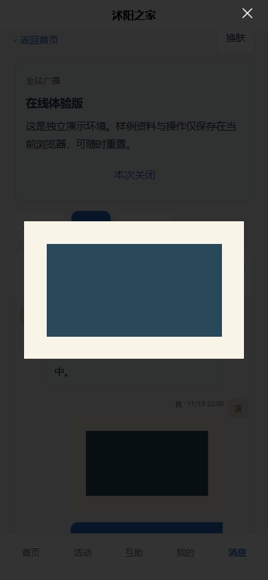
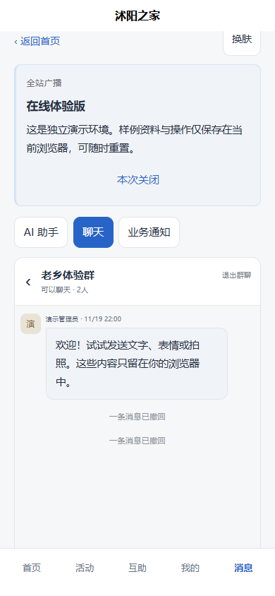

# v2.0.3 上线复查与问题修复

检查日期：2026-11-19。基于 v2.0.2，检查论坛引用回复、发帖返回、通讯录、大屏素材管理、聊天图片预览以及普通请求／上传错误恢复。本轮确认以下7类问题，均已修复，并同步更新独立演示。

## 问题清单

| 编号 | 复现条件与影响 | 修复结果 |
| --- | --- | --- |
| 1 | A拉黑B后，B仍能在第三人的主题中引用A的楼层定向回复 | 引用楼层时检查双方拉黑关系并拒绝；仍允许普通参与第三人的主题，解除拉黑后可恢复引用；隐藏楼层及跨主题引用继续禁止 |
| 2 | 发帖请求未返回时离开表单，再新建草稿或进入另一主题，旧成功会关闭新草稿、旧失败会污染当前页面 | 响应同时核验身份、原草稿对象和页面版本，只更新发起请求时的表单 |
| 3 | 客户端收到同一账号的enabled=false后，通讯录和大屏仍保留私人联系人、编辑／删除确认、管理素材，迟到响应还会恢复这些内容 | 启用状态参与权限判定；停用即清空私有状态、取消旧响应、禁止继续编辑或提交；服务端仍独立鉴权 |
| 4 | 重复加载大屏素材列表时旧响应覆盖新列表；收起管理后在途响应又展开面板 | 只接受最新一次管理请求；收起时取消在途管理结果并清理旧编辑／删除确认 |
| 5 | 手机正在全屏查看聊天图片，图片被撤回后消息已消失，但平台预览仍停留 | 附件组件移除时关闭其拥有的全屏预览并释放H5图片资源；移除其他图片不会误关当前预览，迟到下载不再弹出 |
| 6 | Web普通请求遇到null、数组或错误消息对象时显示TypeError／[object Object]；401正文未完成时仍保留旧登录状态，正文超时被当成JSON错误 | 校验响应结构、只显示字符串错误文案；收到401响应头立即清理匹配的旧会话；正文读取超时保留明确超时提示，迟到401不影响新账号 |
| 7 | H5／小程序上传收到网关HTML或null时展示英文解析错误；Web上传null也报内部异常 | 双端统一显示中文上传响应异常及重试提示，保留合法服务端校验文案，失败后可明确重试，不清除有效会话 |

第3项针对客户端已经得知账号停用的状态变化；没有新增持续在线账号状态同步机制。第5项控制后续界面展示，不能撤回对方已保存的图片；通过普通聊天轮询获知撤回，非即时推送承诺。

## 验证结果

| 检查 | 本轮实测 |
| --- | --- |
| 后端clean verify | 218项，0失败、0错误、0跳过 |
| 前端test:regression | 414项通过，含新增请求错误29项、聊天预览8项、论坛／通讯录／大屏状态16项 |
| 演示数据层 | 28项通过，新增引用楼层拉黑规则与后端一致性检查 |
| 演示页面／高铁论坛 | 20项／32项通过，覆盖拍照上传、审核、语音、三主题和320／390／1440px布局 |
| 手机H5聊天预览 | 新增5项真实浏览器流程全部通过，0页面异常、0 API失败 |
| 类型检查与构建 | Web vue-tsc、移动端tsc通过；Web、H5、微信小程序、独立演示四种构建通过 |
| 正式JAR与临时加密库 | 9项通过，含首次改密、真实申请审核、持久化、停机备份及恢复 |
| Nginx HTTPS | 16项通过，另验证Web／H5手机页面及高铁版主权限保存；正式静态文件无演示控件 |

新增回归先验证原缺陷：论坛后端新增4项中旧代码1失败；演示引用拉黑新增用例旧代码失败；前端请求错误29项旧代码21失败、聊天预览8项旧代码4失败、论坛／通讯录／大屏16项旧代码14失败，修复后全部通过。回归中也确认群聊退出后的历史与附件访问被拒绝、附件不能跨会话或冒用、私聊拉黑后不能发送新消息和上传；这些通过的既有行为未另作修改。

真实H5预览验收采用390×844视口、虚拟会员和程序生成的PNG：从页面登录进入群聊，打开第一张图片；通过独立请求撤回第二张图片，正常轮询后第一张仍可预览；再撤回第一张，全屏预览关闭，消息显示已撤回。图中不含真实会员或真实照片。

| 正在预览合成图片 | 撤回后关闭预览 |
| --- | --- |
|  |  |

测试入口见[scripts/README](../scripts/README.md)。原始日志与完整截图留在被Git忽略的`.cache`、`output`，不上传数据库和运行时资料。

## 交付与剩余事项

`shuyang-home-v2.0.3.zip`包含后端、Web、H5、微信小程序开发构建、部署模板、说明及逐文件SHA256清单，附ZIP校验文件。JDK 21、H2 2.4和v2.0.x数据格式保持一致，从v2.0.0／v2.0.1／v2.0.2升级无需额外数据迁移。

升级前停机备份数据库及私有配置，保留旧版文件和静态哈希资源。不要给已有数据库重新生成密码或数据密钥。首次安装、服务替换和回退步骤见[上线准备](上线准备-v2.0.0.md)。启动后从新包目录执行：

```bash
python3 tools/check-deployment.py https://自己的域名 --mobile
```

尚未配置正式服务器、域名与微信AppID，GitHub Pages是独立体验版。Android／iPhone微信的拍照、定位、文件选择及小程序界面仍需真机验收；本轮小程序验证包括编译和平台调用模拟，不等同于真机通过。

本轮没有升级依赖，未重新执行依赖审计。v2.0.1记录的32项uni-app上游告警（17 high、8 moderate、7 low）仍列为未完成事项，详见[依赖边界说明](上线复查与问题修复-v2.0.1.md#依赖修补及剩余事项)。
