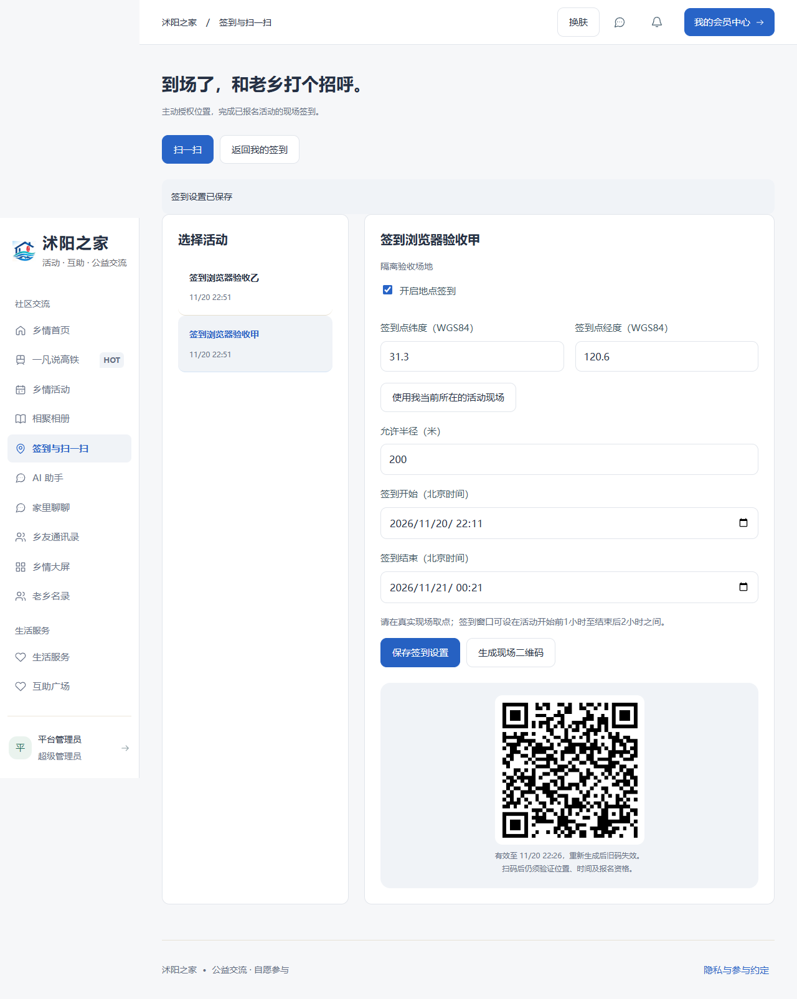
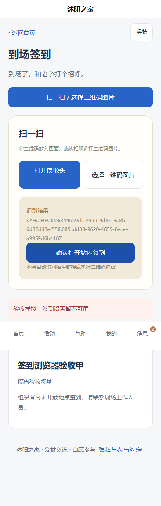
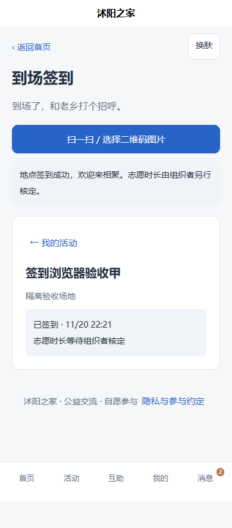

# v2.0.4 上线复查与问题修复

检查日期：2026-11-20。基于v2.0.3，重点检查活动签到、相机与图片扫码、资源互换、众筹认领，以及Web／移动端表单与确认弹窗。本轮确认9类问题并逐项修复。

## 问题清单

| 编号 | 复现条件与影响 | 修复结果 |
| --- | --- | --- |
| 1 | 同一众筹认领重复核实交付，会覆盖首次核实人和时间；重复取消还会增加业务版本并重复记录审计 | 鉴权后返回已完成的同一操作结果，保留首次核实和取消记录；资金意向不能标记收款或交付，其他会员不能代为取消 |
| 2 | 资源申请已被接受后，网络重试因资源已变成“交换中”而错误返回不可申请 | 优先返回本人已有的待处理／已接受申请，避免重复申请；创建新申请仍校验可用状态，终态规则与权限保持生效 |
| 3 | 资源、众筹、联系、广告、投票或活动提案的旧操作尚未返回时打开新表单，旧成功关闭新表单、旧错误覆盖新页面；Web列表未刷新完就解除提交锁 | 操作及错误绑定发起时的视图，切换后忽略旧界面结果；提交锁覆盖写入和后续刷新，减少重复操作 |
| 4 | 手机原生确认弹窗打开后切换页面，迟到确认仍能执行旧操作；旧弹窗或重复回调可能再次提交 | 确认绑定账号、视图版本与一次性序号，换视图、被新确认替代或已处理后立即失效 |
| 5 | 同一活动的旧配置覆盖新配置；活动A→B→A时旧定位仍可签到；扫码查询晚到覆盖手动选择 | 每次活动选择均独立计数，旧配置／定位／查询失效；停用账号、退出和卸载也会取消在途操作，列表重试成功清除旧错误 |
| 6 | 管理员切换活动、退出或离开后，较早的现场定位、保存、二维码绘制仍写回页面；重复保存可提交多次 | 定位、保存和二维码逐步核验当前选择；配置读取期间禁止提交，保存直接使用服务端返回配置，保留有效设置，重复点击只发起一次操作 |
| 7 | 选新图片后旧二维码仍可确认；连续选两张图，先选图片的迟到结果或错误覆盖后选图片 | 开始新识别时清空旧结果，仅接受最新识别，失败可重新选择同一图片；取消及卸载释放图片对象URL |
| 8 | 相机停止再重开时，旧启动请求晚到会覆盖新控制器，停止或卸载可能遗留摄像头；ZXing旧控制器还会清空新预览 | 过期控制器主动停止，每次启动使用独立原生视频节点，旧回调不影响新相机；停止、换图片及卸载统一使旧操作失效 |
| 9 | 正式H5构建把扫码依赖输出为以`..-..-node_modules`开头的文件名，却生成没有`./`前缀的动态导入；浏览器无法加载解码库，有效二维码也提示识别失败 | 修正移动构建中的依赖分块命名，生成可被浏览器解析的相对路径；用正式构建及真实HTTPS代理验收管理端生成的签到码 |

第3、4、5、6项处理界面和异步操作归属，不撤销已被服务端接受的业务写入。签到仍由服务端检查报名、活动状态、时间、定位精度和距离；没有以网络城市定位替代现场精确定位。相机测试中的迟到许可会在返回控制器后立即停止，不承诺取消浏览器自身尚未结束的授权弹窗。

## 验证结果

| 检查 | 本轮实测 |
| --- | --- |
| 后端clean verify | 223项，0失败、0错误、0跳过 |
| 前端test:regression | 496项通过，含签到19项、扫码15项、模块操作48项新增回归 |
| 类型检查与构建 | Web vue-tsc、移动端tsc通过；Web、H5、微信小程序、独立演示四种构建成功 |
| H5模块导入检查 | 5个导入（含4个动态导入）全部使用相对路径且目标文件存在，已接入构建及CI |
| 演示数据层 | 28项通过 |
| 演示页面／高铁论坛 | 20项／32项通过，含拍照上传、会员码图片核验、三主题及手机布局 |
| 手机H5聊天预览 | 5项通过，包含撤回当前图片后关闭预览、撤回其他图片不误关预览 |
| 正式JAR安装与恢复 | 9项通过，包含临时加密文件库、首次改密、会员审核及停机恢复 |
| Nginx HTTPS及生产页面 | 16项部署检查、3项Web／H5手机页面与版主权限流程通过 |
| 实际签到页面 | 新增9项通过：Web保存及生成码→H5图片识别→模拟授权定位→服务端签到持久化，另含坏图、503恢复和陌生链接拒绝 |

新增回归执行实际组件、共享逻辑或HTTP接口。后端5项在旧代码中有3项失败；签到19项旧代码18项失败、扫码15项旧代码12项失败、模块操作48项旧代码33项失败，修复后全部通过。并发认领不会超额、取消后重试不会恢复额度、满额项目拒绝新认领等既有规则也在本轮重新验证。

实际签到页面验收另外发现第9项构建问题：原始PNG通过直接解码检查，但浏览器加载扫码依赖时抛出模块路径错误；原H5产物检查精确报出2个错误动态导入。调整分块文件名后，检查全部通过，未更换扫码依赖或放宽浏览器安全策略。

正式构建的签到流程使用真实HTTPS代理与后端、390px手机视口、虚构账号和活动。管理员通过页面保存WGS84坐标、半径、北京时间窗口并生成码，手机端识别同一图片，再通过浏览器模拟位置完成签到；独立API读取确认服务端已保存签到。没有页面异常、损坏静态资源或陌生网址跳转；控制台唯一错误来自主动注入的503，页面保留扫码入口并可重试恢复。

管理员配置与二维码截图：



| 手机识码失败后可重试 | 定位核验后签到成功 |
| --- | --- |
|  |  |

测试入口和环境见[scripts/README](../scripts/README.md)。测试使用隔离数据库、虚构账号、测试活动及程序生成的图片；原始日志和完整截图保存在被Git忽略的`.cache`、`output`中。

## 交付与剩余事项

`shuyang-home-v2.0.4.zip`包含后端、Web、H5、微信小程序开发构建、部署模板、说明和逐文件SHA256清单，附ZIP校验文件。从v2.0.0～v2.0.3升级无需额外数据迁移，JDK 21及H2 2.4要求保持不变。

升级前停机备份数据库和私有配置，保留旧版文件及静态哈希资源，不要重新生成现有数据库的密码或数据密钥。首次安装、替换及回退见[上线准备](上线准备-v2.0.0.md)。启动后从新包目录执行：

```bash
python3 tools/check-deployment.py https://自己的域名 --mobile
```

当前尚未部署正式服务器、配置正式域名或微信AppID，GitHub Pages仍是独立体验版。Android／iPhone微信的拍照、相机授权、定位、文件选择及小程序界面仍需真机验收；浏览器模拟定位和小程序编译不能替代真机验收。

本轮没有升级依赖，也未重新运行依赖审计。v2.0.1已记录的32项uni-app上游告警（17 high、8 moderate、7 low）继续列为未完成事项，见[依赖边界说明](上线复查与问题修复-v2.0.1.md#依赖修补及剩余事项)。
