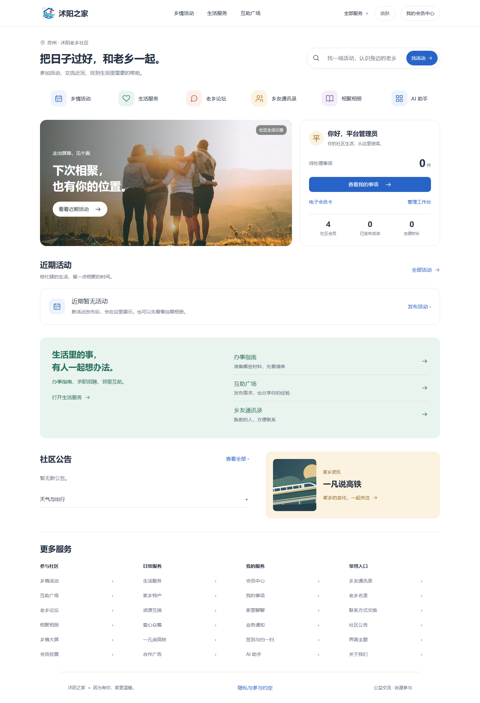
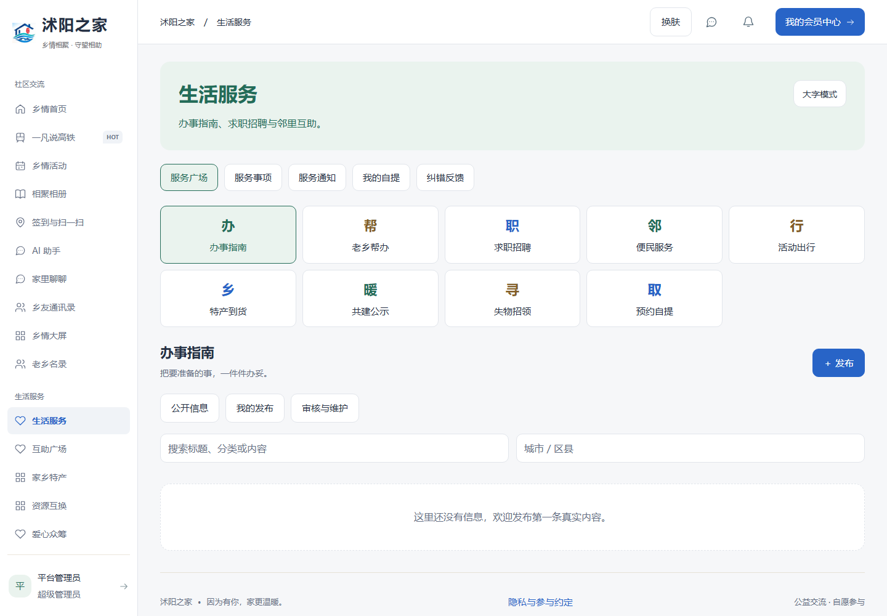
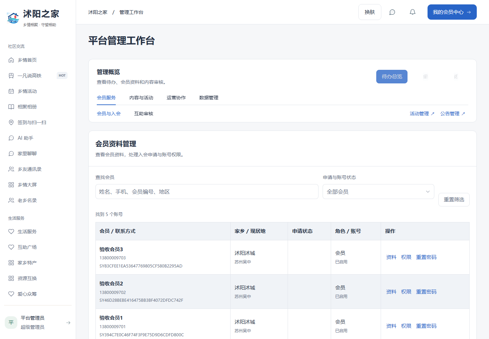

# v1.10.0 全站界面优化

采用用户选择的“生活社区型”方向：首页参考 [Airbnb](https://www.airbnb.cn/) 的内容发现、搜索和卡片层级；业务界面参考 [飞书](https://www.feishu.cn/) 的中文排版与导航分组，并结合 [Ant Design设计模式](https://ant.design/docs/spec/overview-cn/) 的表单和数据展示规范。保留沭阳之家标志、现有业务及Element Plus组件。上述公开参考页已浏览；未访问其私人工作区。

## 改动范围

- 首页：提供活动搜索和六个常用入口，以相聚照片、个人待办、活动卡片、生活互助、公告及家乡专题组织内容。照片明确标注为生活示意，素材来源见[素材说明](界面素材来源.md)。保留会员卡、我的事项、管理工作台、天气、广告、全站广播和高铁专题入口。
- 导航：首页采用紧凑横向导航，电脑业务页面保留分组侧栏；手机和平板通过“全部服务”访问完整菜单。
- 工作台与资料管理：统一页面标题、查询条件、表格行高、表单控件、状态标签和空态。手机继续使用会员资料卡片。
- 会员中心、聊天、论坛、相册、生活服务、通讯录、大屏及文件中心：统一底色、边框、按钮和文字层级。保留原权限、提交流程和主题偏好。
- 文案：将活动、互助、生活服务等页面的宣传式标题改为功能名称，减少重复英文与装饰标签。

## 字体与颜色

| 内容 | 主要字号 |
| --- | --- |
| 首页主标题 | 电脑32px；手机23–25px |
| 业务页标题 | 电脑28px；手机26px |
| 正文与输入框 | 16px |
| 按钮与表格正文 | 15px |
| 表单标签、说明与辅助信息 | 14px为主 |

导航和状态文字根据空间适当调整；首页统计标签使用12–13px，手机常用入口使用14px。保持至少44px的主要触控高度，生活服务保留大字模式。

以白色、浅灰作为基础，蓝色表示主要操作，青绿用于生活服务与志愿信息，暖金用于家乡专题，深蓝用于会员卡。深色主题同步调整背景、文字与强调色，保留竹青、温暖乡情和跟随系统选项。

## 检查发现与修复

| 问题 | 处理 |
| --- | --- |
| 历史样式中混用渐变、蓝金色块和不同字体 | 使用共享主题变量和统一页面层级，采用适度色彩、实用内容和清晰的阅读层级 |
| 辅助文字过小，阅读层级不一致 | 增大正文、输入框、表格和说明字号，检查小屏换行 |
| 深色会员卡浅底浅字、生活服务深底深字 | 为卡片指定稳定的前景／背景配对，修正H5页面样式加载顺序造成的覆盖 |
| 小屏首页标题孤字换行 | 调整320px字号及标题长度 |
| 平板隐藏侧栏后缺少完整导航 | 业务页面增加“全部服务”菜单，点击后自动收起 |

## 验证

- 前端277项回归、演示数据层20项通过；本轮后端170项测试已通过，后续视觉调整没有修改后端。
- Web与移动端类型检查通过；Web、H5、微信小程序、演示版及后端生产构建通过。
- 全站双内核页面检查102项：覆盖首页、工作台、会员中心、活动、事项、生活服务、通讯录、大屏、论坛、聊天、资源、商城、主题、会员管理、文件中心与登录；检查1440、390、320px布局及768、1024px平板导航，另检查深色页面和H5首页／生活服务。
- AI与会员二维码在Chromium、Windows WebKit各15项页面链路通过：同意后发送、失败恢复、纯文本显示、二维码图片识别、工作人员核验、刷新撤销旧码、离页清空和手机适配。
- Pages演示19项页面检查通过，新增首页活动搜索和三个宽度下的首页验收，包括子路径资源、报名、审核、拍照、聊天、会员码、身份切换、本机存储隔离及重置。

截图来自隔离内存数据库中的虚构账号。微信小程序仅通过类型与构建检查，真实手机摄像头、微信扫码及真实模型服务仍需部署环境验收。详细接口和配置见 [AI助手与会员二维码](AI助手与会员二维码-v1.10.0.md)。

## 预览

