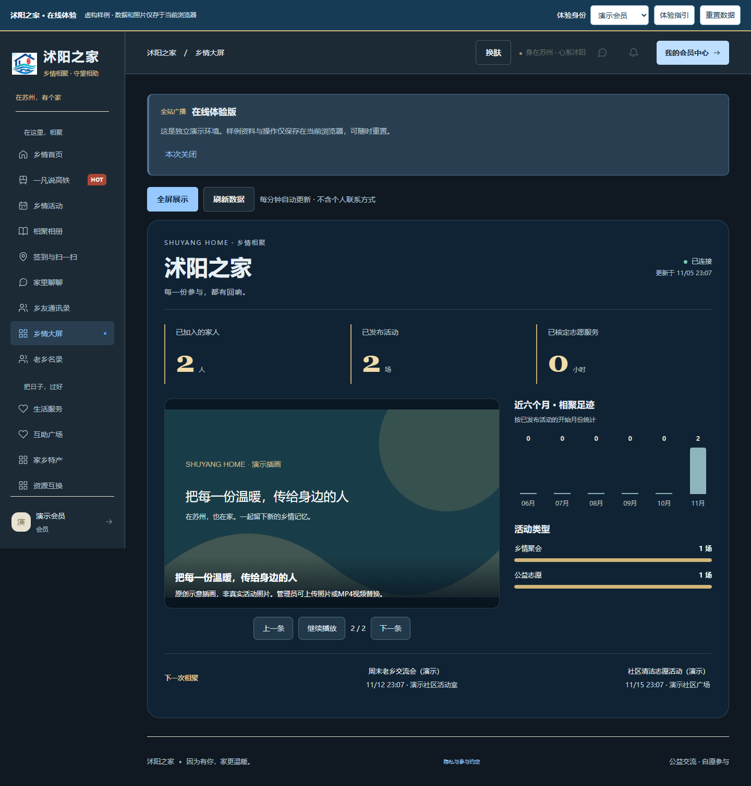
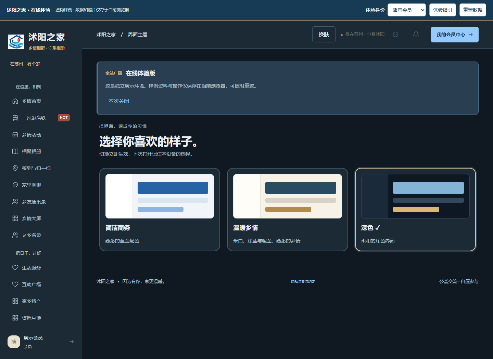
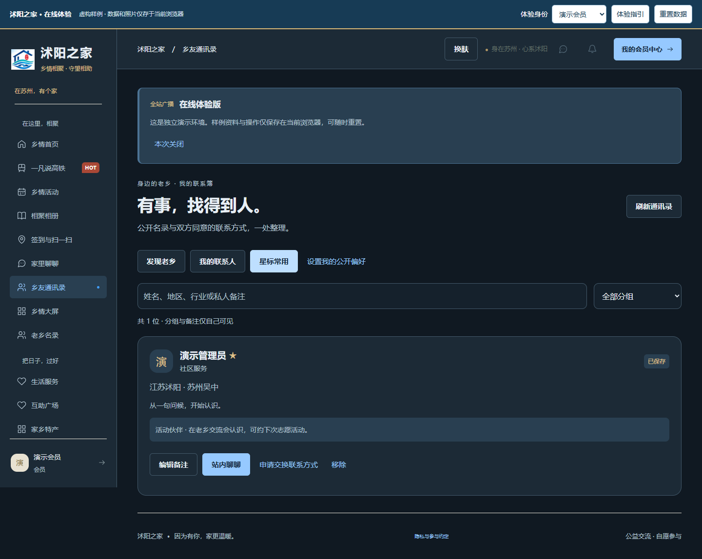

# v1.9.0 大屏、通讯录与在线演示

演示地址：https://guhang2011.github.io/shuyang-home/

顶部可直接选择演示会员、管理员或游客。登录账号为 `demo`（会员）、`admin`（管理员），密码均为 `Demo12345678`。这些账号仅存在于独立演示构建，正式后端仍需配置自己的管理员密码。

## 本版功能

| 入口 | 使用方式 |
| --- | --- |
| 乡情大屏 | 查看公共会员、活动、核定志愿时长和六个月活动图表；轮播照片及MP4，暂停、上一条、下一条、全屏，每分钟刷新 |
| 管理播放素材 | 管理员／组织者上传JPG、PNG（8MB内）或MP4（15MB内），设置顺序、照片停留秒数、草稿或公开；发布需确认展示权限 |
| 乡友通讯录 | 发现公开名录中的乡友，保存分组、私人备注和星标，搜索、站内聊天或申请交换联系方式 |
| 界面主题 | 温暖乡情、简洁商务、深色三套主题，记住设备偏好；顶部换肤仍保留竹青和跟随系统 |
| 生活服务 | 指南、帮办、招聘、服务、出行、到货、自提、公示与失物招领，详见生活服务说明 |

大屏不会公开会员电话、私人备注或聊天内容；未发布素材不能被游客直接下载，撤下后再次请求会重新检查权限。正式后端通过当前公开偏好、交换同意及拉黑状态投影通讯录，备注仅属于保存者。音视频提供范围请求，方便浏览器拖动播放。

## 公网演示范围

演示站点是 GitHub Pages 静态应用，通过 Service Worker 和 IndexedDB 在每个访客浏览器中运行。首次访问需要 HTTPS、现代浏览器及可用本地存储。

- 可体验大屏、照片／视频素材管理、通讯录、三套主题、论坛发帖与审核、聊天、相册、活动报名、订单及管理待办。
- 生活服务演示支持浏览指南与私人清单；招聘、帮办、自提等完整流程需运行后端服务，界面会明确提示演示范围。
- 默认大屏素材为原创示意插画，不是真实活动照片；演示会员、活动、商品均为虚构。
- 数据与上传附件只留在当前浏览器，访客之间不共享；刷新保留，顶部“重置数据”可恢复样例。不存在真实付款、发货或跨设备消息发送。
- 天气定位、真实签到与完整文件报表不纳入本次静态演示。

## 验证

合并在 v1.8.0 基础上完成，保留原有广播、论坛置顶热帖、拍照和在线演示。

- 后端142项测试通过，包括通讯录权限、联系方式撤销、素材权限、MP4校验、范围请求和生活服务流程。
- 前端249项回归、演示数据层16项测试通过；Web与移动端类型检查通过。
- Web、H5、微信小程序、Pages演示生产构建通过；后端发布JAR已打包。
- Chromium浏览器31项检查通过，覆盖桌面与320／390／768px布局、主题保存、大屏全屏与切换、照片发布、通讯录备注隔离、指南清单以及游客权限。

微信小程序已编译，仍需填写真实AppID及HTTPS域名并完成微信开发者工具、Android和iPhone真机验收。MP4建议使用H.264编码；文件通过格式校验不保证所有设备均能解码。

## 截图

手机：[通讯录](screenshots/contacts-phone-190.png)、[乡情大屏](screenshots/display-phone-190.png)。截图为本地独立演示环境，全部使用虚构资料。
