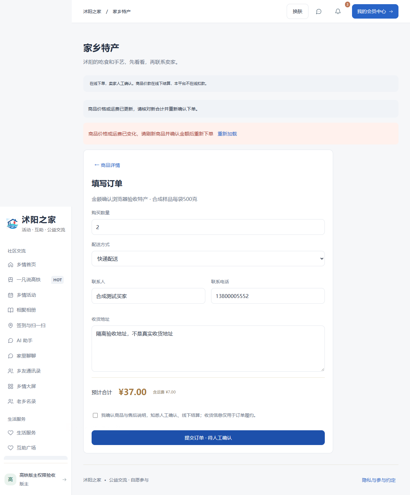
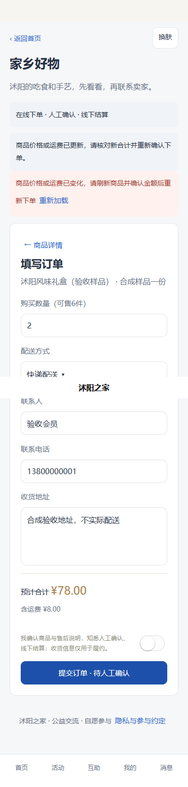

# 家乡特产订单复查 · v2.0.6

2026 年 11 月 25 日。本轮从会员下单、管理员确认、通知发货或自提，一直检查到收货、线下退款与库存回补。公开演示采用浏览器内的虚构商品。正式服务通过独立数据库和测试账号验收。

| 问题 | 修复后的行为 |
| --- | --- |
| 会员确认金额后，卖家在提交瞬间调整单价或运费，系统会按新金额创建订单 | 新版网页和手机端提交确认过的单价及本单运费。出现差价时服务端保留库存，页面显示新合计并清除勾选。自提运费为零 |
| 返回商品详情再填写，联系地址和本次提交编号丢失 | 在同一次登录、同一应用运行期间保留每件商品的草稿。返回时若价格已变，需要重新确认。退出应用后草稿随内存释放 |
| 最后一件商品下单成功却丢失响应，重试可能因售罄而受阻，或产生第二次购买 | 页面先查本人的订单。已扣完库存的商品详情提供“继续确认上次订单”。按原提交编号核对或重试，正式服务和演示都只创建一单 |
| 商品和订单共用加载流程，商品接口失败会挡住已有订单。停在详情也可能看到旧库存或旧状态 | 两份列表分别读取。打开详情、切换列表和手机重新回到前台都会刷新。商品下架时关闭新的购买入口，订单读取失败时可以重试 |
| 确认、发货、自提备妥、结算或收货已成功，再试一次却被提示失败 | 相同操作返回当前订单状态，保留首次保存的履约和结算说明。不同说明会提示冲突 |
| 普通取消后再登记退款，或在退款重试中改备注，系统仍提示退款成功 | 只有管理员对已登记退款重复提交相同说明时才返回原结果。并发取消和重复退款均只归还一次库存 |
| 演示端旧编辑表单会覆盖已扣减的库存，订单缺少卖家和规格，发货后“我的事项”直接显示已处理 | 保存编辑时检查库存版本。新订单记录订单号及购买时的商品和卖家资料，已发货或待自提的会员可在“我的事项”确认收货。以前缺号的演示订单按既有记录补充稳定编号 |

## 浏览器实测

真实 HTTPS 测试使用打包的 Java 后端、Nginx 和正式 Web 构建。商品原价每件 12.50 元，运费 5 元，两件共 30 元。会员已勾选确认后，管理员把单价调到 15 元、运费调到 7 元。第一次提交返回 409，数据库的订单数、库存和库存版本均保持原值。页面显示 37 元并取消勾选。会员重新确认后创建一单、扣减两件，再从订单页取消后恢复原库存。

Web 和 390 像素宽的 H5 浏览器还通过隔离的演示接口模拟写入成功、响应丢失和订单查询同时失败。会员从详情重新打开草稿后找回同一单。取消后的响应再次丢失时，重复操作仍只归还一次。下图数据均为测试样品和合成联系资料。

| 桌面网页重新确认金额 | 手机 H5 提示新合计 |
| --- | --- |
|  |  |

| 核验 | 结果 |
| --- | --- |
| 后端完整测试 | 239 项通过，含 12 项新增商城 HTTP 测试 |
| 前端统一回归、Web 与移动端类型检查 | 全部通过，共享生活服务与商城专项 42 项通过 |
| 浏览器 | Web／H5 商城 18 项、真实 HTTPS 商城 5 项、演示页面 22 项通过 |
| 演示数据层 | 39 项通过，包括旧订单补号、库存冲突、改价和退款 |
| 部署 | Web、H5、小程序开发版、Pages 演示版构建通过。正式 JAR 安装与备份恢复 9 项，HTTPS 部署 16 项、生产页面 3 项及活动签到 9 项通过 |

## 升级

沿用 v2.0.x 数据库格式。部署包内的网页、H5、小程序和后端应一同更新，才能使用下单时的金额确认。旧客户端暂时仍可下单，它发送的请求没有确认过的价格，服务端会采用下单时的商品价格。收货地址草稿只保存在当前应用的运行内存中。发布微信小程序仍需配置正式域名、AppID，完成 Android 和 iPhone 真机验收。部署命令见[上线准备](上线准备-v2.0.0.md)。
