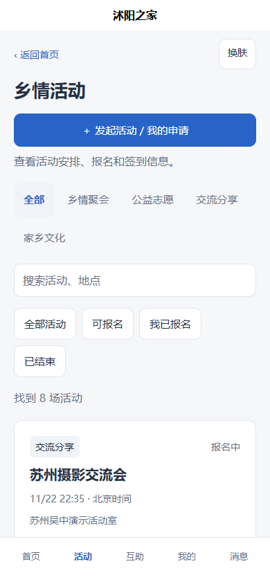
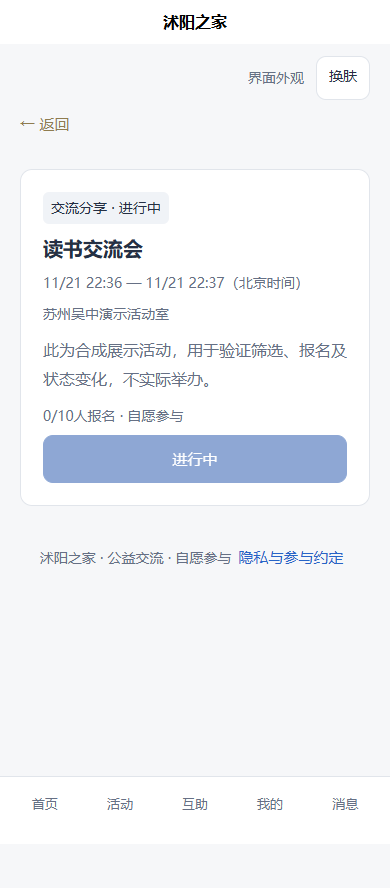

# v2.0.5 活动报名与手机签到复查

2026-11-21。基于 v2.0.4，检查会员从查找活动、报名、取消报名到扫码签到的流程，也检查管理员修改和取消已有人报名的活动。

| 问题 | 触发条件 | 修复结果 |
| --- | --- | --- |
| 已报名却收到失败提示 | 会员报名成功后遇到断网，再次请求时活动已经开始 | 接口返回本人已有报名。若已签到，返回原签到和已核定时长。开场后仍会拒绝首次报名 |
| 时间已过仍能看到报名或取消按钮 | 停在活动详情或“我的”页面时，活动跨过开始或结束时间 | Web 和手机端共用活动时钟。列表、详情和取消按钮在时间边界更新，点击报名时再检查一次 |
| 刷新后详情和列表的人数不同 | 打开详情后最后一个名额被其他人占用，提交报名失败 | 刷新后把列表中的当前活动同步到已打开的详情，更新名额、报名状态和按钮。Web 弹窗内可直接刷新，活动从公开列表撤下时同步关闭旧详情 |
| 管理员只改标题也被判定为改期 | 活动原始时间包含秒，编辑框只显示到分钟，有人报名后改标题或取消活动 | 开始和结束时间分别保留原值，只有实际修改了显示分钟才转换新的北京时间。完整表单可以保存标题或取消活动 |
| 微信取消扫码被提示识别失败，重扫仍可能确认旧码 | 用户取消相机、重复点击、选取另一张码或识别失败 | 取消正常返回。重扫立即清理旧结果，保留原活动。相机请求和确认分别限制为一次，网络失败后可重试当前码 |
| 旧扫码确认影响新活动或新账号 | 扫码等待期间切换活动、账号、退出组件，或在手机网页收起再打开扫描器 | 处理回调时检查其所属账号、扫描和活动。旧回调失效，保留当前操作的状态 |
| 在线演示的参与名单、个人记录及取消行为不一致 | 取消后重新报名会新增记录，名单包含取消者，整场取消后仍有有效报名，已签到记录还可能显示为已取消 | 每位会员每场活动复用一条记录。名单只显示当前参与者，取消整场活动同步更新报名，“我的事项”反映签到及结束状态。升级时合并旧演示缓存内的重复报名 |
| 手机首屏看不到活动 | 390×844 视口下，“我的活动发起”空列表占据上半页 | 顶部保留“发起活动／我的申请”入口，点击可查看自己的申请或打开发起表单。首屏直接显示第一场活动的名称、时间、地点 |

## 验证

后端 `clean verify` 通过227项，0失败、0错误、0跳过。新增4项 HTTP 回归覆盖开始后重试、已签到记录、取消及跨管理员核定。其中2项在旧版本返回错误，修复后4项全部通过。

前端逻辑回归通过554项。新增22项 Web／手机活动状态测试，在旧代码上6项通过。新增36项原生及 H5 扫码测试，在旧代码上5项通过。两组修复后全部通过。Web 和移动端类型检查完成，Web、H5、微信小程序开发版和 Pages 演示版构建完成。

演示数据层33项通过。新增5项覆盖旧数据合并、重新报名、报名截止、取消活动与已签到记录，5项均在旧代码上复现失败。演示浏览器22项通过，包含管理员从页面保存完整表单，仅改标题后再次打开并取消同一活动，独立读取时间戳和参与名单验证结果。

活动浏览器专项在 Web 和 H5 正式构建上通过9组检查。使用合成活动验证首屏布局、发起入口、筛选和搜索、抢满后刷新、取消后释放名额、跨开始和结束时间的按钮状态。页面脚本异常与意外 API 错误均为0。截图内的名称、场地和时间用于测试。

| 390×844 手机活动首屏 | 打开详情后活动开始 |
| --- | --- |
|  |  |

本地 HTTPS 代理通过16项部署检查、3项生产页面检查和9项实际签到流程。正式 JAR 的安装与备份恢复通过9项。高铁论坛32项及聊天预览5项浏览器回归通过。

## 部署与复验

本版继续使用 v2.0.x 的服务端数据库格式。升级前备份数据库和私有配置，按[上线准备](上线准备-v2.0.0.md)替换文件。演示报名记录的整理仅作用于访客浏览器中的演示数据。

原生扫码回归使用受控的 `uni.scanCode` 回调。微信在 Android 和 iPhone 上的真实相机转场、定位权限及扫码体验仍需在配置正式域名和 AppID 后验收。此前记录的32项 uni-app 上游依赖告警见[依赖复查记录](上线复查与问题修复-v2.0.1.md)。
