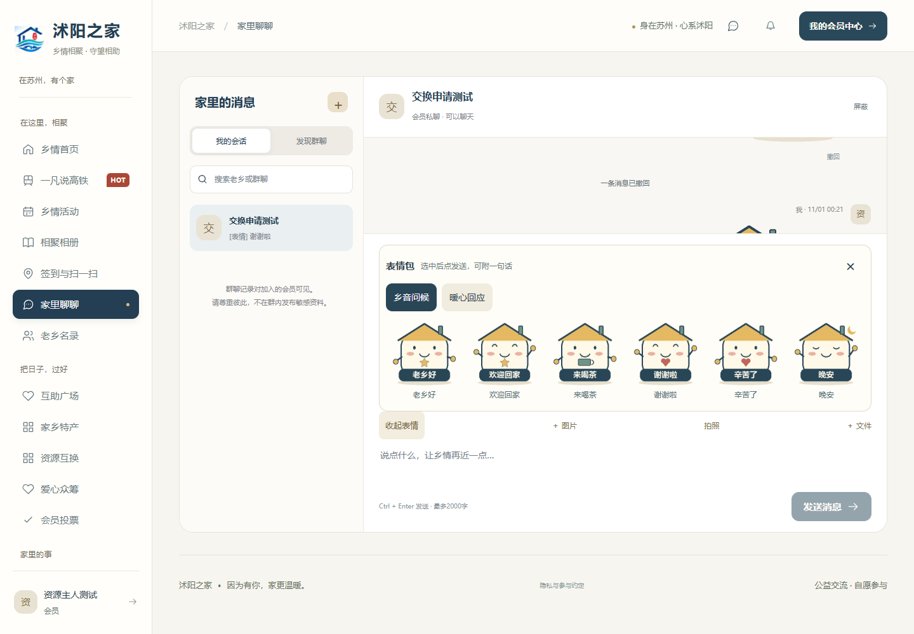

# 聊天表情包 · v1.4.0

私聊和自愿加入的群聊均可发送表情。Web、手机 H5、微信小程序共用相同目录与消息接口。

## 使用

1. 进入可以聊天的会话，点击输入区的“表情包”。
2. 切换“乡音问候”或“暖心回应”，点击表情，查看待发送预览。
3. 可附一句文字，也可直接点击发送。选择表情不会立即发送。
4. 不想发送时点击“移除表情”，输入的文字仍保留。自己的消息在两分钟内可撤回。

内置两组、共12张原创透明 PNG：老乡好、欢迎回家、来喝茶、谢谢啦、辛苦了、晚安、收到、真棒、加油呀、哈哈哈、抱抱、期待相聚。素材随后端打包，不依赖第三方图床。首版提供内置静态表情，不含自定义上传、收藏或 GIF 包管理。

表情和图片／文件附件分开发送，选择其中一种后会禁用另一种；附带文字不受影响。发送失败保留表情和草稿，直接重试即可。切换会话、返回列表或退出账号会清除待发表情，避免发错会话。目录失败提供“重新加载”，单张图片加载失败显示 `[表情] 名称`。

截图中的会员及聊天数据均为本机隔离验收数据。

## 接口与兼容

| 接口 | 说明 |
| --- | --- |
| `GET /chat/sticker-packs` | 获取内置分类、表情 ID 与中文名称；无会员数据 |
| `GET /chat/stickers/{id}.png` | 获取内置原画；公共缓存一天 |
| `POST /chat/conversations/{id}/messages` | 原消息接口新增可选 `stickerId`；与 `content` 可共存，与 `attachmentId` 互斥 |

只接受目录内的 ID，不接受外部图片地址。消息继续遵守私聊接受状态、群成员、账号状态、屏蔽和撤回规则。原画公开不代表会话公开，第三人不能获取私聊记录。

消息返回 `sticker: {id, label, packId}`。纯表情同时返回 `stickerOnly: true` 及文字降级 `content`，新版只显示图片，旧客户端仍能看到表情名称。撤回响应、历史与轮询均不再返回表情内容；重复请求不会让撤回的图片重新出现。保留旧目录 ID 和图片可保证历史消息继续显示，不应直接删除已发布的表情 ID。

目录唯一来源为 `backend/src/main/resources/stickers/catalog.json`。生成脚本 `scripts/generate-chat-stickers.py` 使用 Pillow 和中文字体重建 PNG；默认使用 Windows 微软雅黑，可通过 `STICKER_FONT` 指定其他中文字体。运行系统不需要 Python、Pillow 或字体文件。

## 本轮验收（2026-11-01）

| 范围 | 结果 |
| --- | --- |
| 前端逻辑 | 160项通过，含14项表情状态、失败重试、重复发送、切换会话／账号、目录异常、撤回合并及图片 URL 校验 |
| 后端集成 | 69项通过，新增4项覆盖目录／12图解码、私聊与群聊权限、并发幂等、非法输入、文字兼容和两分钟撤回 |
| 表情浏览器流程 | Chromium、WebKit 各76项：两端互发、附文字、撤回、目录重试、坏图降级、发送失败重试、七种尺寸的选择／移除／发送可达性 |
| 原移动环境矩阵 | Chromium、WebKit 各112项：首页、商品、订单、会员中心、聊天；触屏、微信 UA、深色、减少动画、时区与短视口模拟 |
| 构建 | Web／移动端类型检查、Web／H5／微信小程序构建、后端打包通过 |

浏览器截图检查确认图片与待发送预览正常显示。网络故障用例主动制造的503、图片加载失败属于预期场景，没有未捕获页面异常。CLI日志由 `python scripts/summarize-chat-stickers.py` 检查，不能仅以CLI退出码判定通过。

以上浏览器尺寸覆盖320、360、390、412、768像素宽度、844×390横屏与390×420短视口。Windows WebKit与微信 UA模拟不能代替 iPhone／Android 微信容器、系统软键盘和微信小程序真机验收；小程序已完成类型与编译验证。
