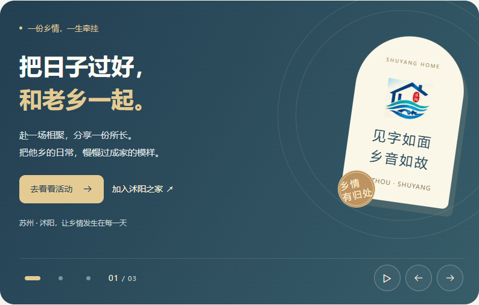
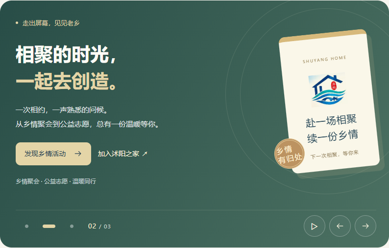
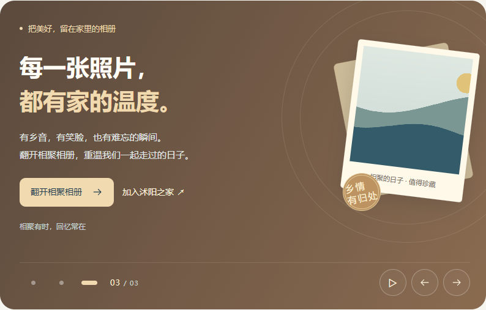
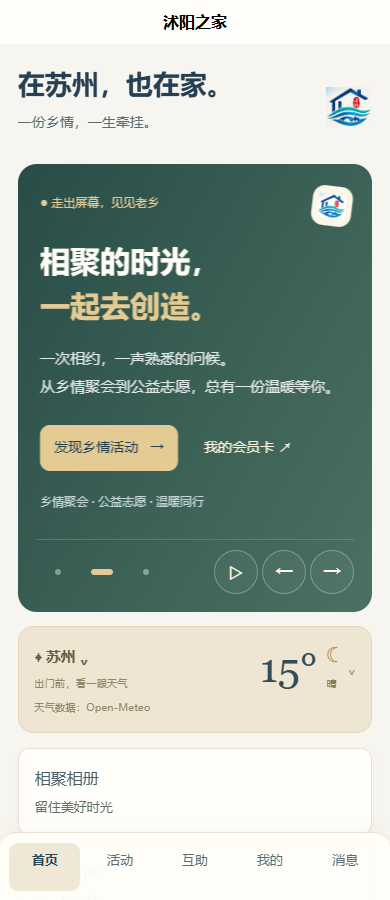

# 首页轮播

2026-10-30：首页欢迎横幅升级为三张内容轮播，保留深蓝、暖金、米白的品牌风格。

| 内容 | 展示 | 主按钮 |
| --- | --- | --- |
| 欢迎回家 | 品牌 Logo 与乡情明信片 | 去看看活动 |
| 乡情活动 | 绿色主题与活动邀请卡 | 发现乡情活动 |
| 相聚相册 | 相片卡与公开相册封面；没有封面或加载失败时显示品牌插画 | 翻开相聚相册 |

三张均保留加入／会员卡入口。文案、顺序及跳转配置在 `frontend/shared/useHomeCarousel.ts`；桌面与 H5／小程序共用配置与播放逻辑。

## 交互

- 默认每 6 秒切换，可点击分页点、上一张、下一张、播放／暂停按钮。
- Web 支持键盘左右键与触摸滑动；H5／小程序使用原生 swiper。
- 鼠标悬停、键盘焦点进入、触摸过程中暂停；页面隐藏或小程序退到后台暂停；离开首页清理定时器。
- 遵循系统减少动画偏好，默认停止自动播放。
- Web 用网格预留三张内容的最大高度；H5／小程序测量各张内容统一高度，窗口尺寸变化时重新计算。切换不会推动下方模块。
- 主要切换控件为 44 × 44 像素；手机窄屏隐藏冗余页码，为手指操作保留空间。

## 验证

- Web、移动端 TypeScript 检查通过；Web、H5、微信小程序生产构建通过。
- 浏览器验证自动播放、循环翻页、分页点、键盘、触摸滑动、悬停／焦点／手动暂停、减少动画偏好、活动／相册跳转与加入／会员卡入口。
- 页面隐藏事件的模拟检查确认后台暂停、返回前台恢复。
- Web 检查 360、390、768、1440 像素宽度；H5 检查 360、390、768 像素宽度。三张高度保持一致，无横向溢出，文字和按钮未被切换栏遮挡。
- 修正移动端请求响应类型判断：排除 ArrayBuffer，确保现有响应校验可通过类型检查。
- 本次触摸验收使用 Chromium 触摸模拟；尚未进行 Android／iPhone 和微信小程序真机验收。

## 截图

截图来自本地隔离验收环境，相册中的山水图是上传功能验收素材，不代表真实活动照片。
